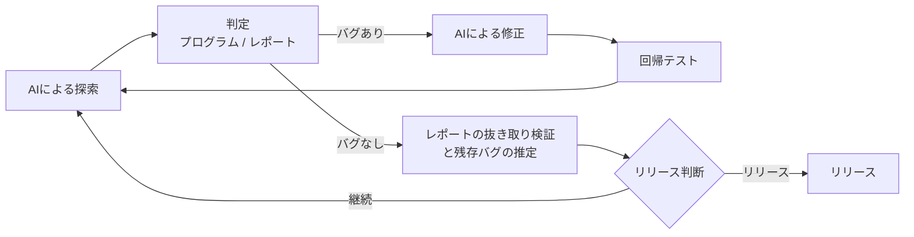
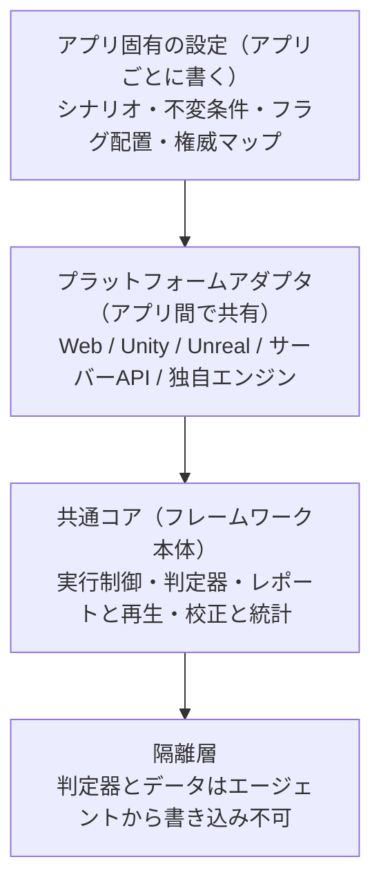

# Custos：AIエージェント開発における自律検証環境の設計

## 名前について

このフレームワークの名前は **Custos**（クストス）とする。ラテン語で「番人」を意味する。

ユウェナリスの句 *Quis custodiet ipsos custodes?*（誰が番人を見張るのか）にちなむ。この設計の核心は、AIの作業を検証するだけでなく、検証する側そのもの（判定器、検証環境、検証役のAI）を検証すること（適合テスト、カナリア、検証役の感度の測定）にある。

| 用途 | 名前 |
|---|---|
| コマンド | `custos`（例：`custos commit`、`custos conformance`） |
| フレームワーク本体のリポジトリ | `custos` |
| アプリごとの検証設定のリポジトリ | `<アプリ名>-custos` |
| .NETのプロジェクトとパッケージ | `Custos.*`（例：`Custos.Core`、`Custos.Cli`）。NuGetに公開しないので、名前の衝突は当面問題にならない（NuGetでの空き状況は未確認） |
| 解析の外部コンポーネント | `custos-analyzer-<用途>`（例：`custos-analyzer-image`）。第12.8節 |
| GitHub App | `custos-<スコープ>` など、他と重ならない名前 |

- テスト用APIのパス（`/__verify/*`）は、アプリのコードに組み込む部分なので、フレームワークの名前に依存しない名前のまま残す。フレームワークの名前を変えても、アプリを変えずに済むようにするためである。
- 同じ名前を使っている既存のソフトウェアがある（2026年11月時点）。リポジトリは非公開なので当面は問題にならないが、公開する場合は、区別できる名前を併記する。

| 名前 | 内容 |
|---|---|
| npmの `custos` | 2016年公開のJavaScriptクライアント（フレームワークはC#で書くので、npmの名前とは衝突しない） |
| npmの `custos-cli` | AIエージェントのツール |
| Apache Airavata Custos | 研究基盤向けのセキュリティサービス |
| GitHubの CUSTOS-CORE | AIシステム向けの、ポリシーで実行を制御する仕組み |

## 1. 背景と目的

- AIエージェントが書いたコードを、人が全行レビューするのは生産性の面で現実的ではない。
- 代わりに検証環境と判定器を用意し、AIが自律的にバグの探索・修正を繰り返すループを回す。
- 目標は「バグがゼロであることの証明」ではない。**残っているバグの量を推定し、それに基づいてリリースを判断すること**を目標とする。

---

## 2. 全体構成

### 2.1 環境の分割

| 環境 | 主な判定方法 |
|---|---|
| セキュリティ | プログラムによる判定が中心 |
| 標準機能 | プログラムによる判定とAIレポートを併用 |
| 性能 | メトリクスによる閾値判定と、ビルド間の比較判定（第13章） |

これらの環境は、アプリごとにゼロから作るのではなく、共通の検証環境フレームワーク（第12章）の上に構築する。

### 2.2 判定方法

判定方法は、プログラムでどこまで確定できるかによって三段階に分ける。

| 段階 | 内容 | 例 | 信頼性の担保 |
|---|---|---|---|
| 1. 機械判定 | 判定器だけで確定する | サーバーダウン、フラグ照合、壁抜け | 判定器自体の検証（カナリア、第17章の陽性確認） |
| 2. 候補検出と確認 | 判定器が候補を出し、AIか人が確定する | ゲームの詰み、レイアウトのはみ出し | 候補の見逃し率と誤検出率 |
| 3. AI判定 | AIのレポートで判定する。AIは一つの方法を試すごとに「この方法を試した。バグは起きた／起きなかった」というレポートを書く | 見た目の崩れ、音質 | 抜き取り検証とバグの埋め込み（第5〜8章） |

段階が上がるほど、統計で補う部分が増える。判定が難しい問題も、一部を段階1や2に寄せられないかを常に検討する。

- **レイアウトの崩れ**：要素のはみ出し、重なり、画面外への飛び出しはDOMの座標から機械的に検出でき、基準画像との差分も使える。「見た目として不自然か」だけが段階3に残る。
- **音質**：音割れ、無音区間、途切れ、ラウドネスのずれは機械的に測れる。「聞き苦しいか」だけが段階3に残る。
- **ゲームの詰み**：その時点で可能な操作をゲームが列挙できれば段階1にできる。できない場合は「進行度が一定時間変わらず、操作できる要素もない」を候補として検出する（段階2）。

### 2.3 環境と判定方法の関係

環境の分け方（何を検証するか）と判定方法（どう判定するか）は別の軸であり、次のように組み合わさる。

| 環境 | プログラムで判定できる | 判定が難しい |
|---|---|---|
| セキュリティ | 情報の窃取（フラグ照合）、侵入、DoSによるサーバーダウン、権威マップの違反 | ほぼなし |
| 標準機能 | クラッシュ、当たり判定、不変条件違反、ゲームの詰み | レイアウトの崩れ、見た目の崩れ、音質 |
| 性能 | サーバーダウン、応答時間、メモリ増加 | 体感的なカクつき |

セキュリティで「判定が難しい」がほぼないのは意図した設計である。判定できない形の攻撃目標は、判定できる形（フラグを取れたか、管理操作の痕跡が残ったか）に定義し直してから環境に載せる。重大な問題ほどプログラム判定に寄せる。

### 2.4 ループの流れ



---

## 3. セキュリティ検証環境

### 3.1 攻撃者から見た目標

- 個人情報の奪取
- 機密情報の奪取
- 運営サーバーへの侵入
- ログインせずにシステムへ侵入すること
- 通信の改ざんによる不正な状態変更（判定方法は第15章）

### 3.2 答え合わせ用システム

- 識別できるダミーデータ（フラグ）を仕込んでおく。攻撃AIの出力にそのデータが含まれていれば「奪取成功」と判定する。考え方はCTFやハニートークンと同じ。
- 盗まれたデータが一部だけだったり、エンコードやハッシュで変換されていたりしても一致と判定できるよう、項目ごとに固有の目印を入れておく。
- 侵入系の目標は、サーバー上に置いたフラグファイルを読み取れたかどうかや、管理操作が実行された痕跡で判定する。
- セキュリティでは、この**プログラムによる合否判定を中心**に据える。

### 3.3 注意点

- 「AIの攻撃が成功しなかった」という結論は、**AI攻撃者の能力の範囲では**という条件付きでしかない。攻撃側の能力がそのまま検証の上限になる。そのため、性質の違う次の手段と併用する。
  - 静的解析（SAST）と動的スキャン（DAST）
  - 依存ライブラリの脆弱性スキャン
  - ファジング
- 第10章の「期待損失によるリリース判断」は、セキュリティには適用しない。実際の攻撃者は脆弱性を一つ見つければ十分で、損失の大きさも極端にばらつくため。**重大度ごとにゼロを目指す**扱いとする。
- 修正AIが「機能を壊して攻撃を防ぐ」ことがある（例：個人情報APIを壊したので奪取できなくなった）。これを防ぐため、**正常系の回帰テストを必ずセットで回す**。

---

## 4. 標準機能の検証環境

### 4.1 プログラムによる判定

- **当たり判定**：箱を用意し、その箱から外に出るという課題をAIに与える。AIの位置が箱の外に移動したことを検知できれば、バグと判定できる。ワープなど正規に外へ出る手段がある場合は、不変条件の例外として明記する。
- **クラッシュ**：プロセスを監視して検知する。ゲームがクラッシュするほどの致命的なバグは、ここで対処する。
- **不変条件**：判定の対象を順次増やしていく。
  - 座標が想定範囲内にあること
  - 数値にNaNや無限大が出ないこと
  - HPなどのパラメータが不正な値（負の値など）にならないこと

### 4.2 AIレポートによる判定

- 「キャラから離れると見た目が崩れる」「UIが崩れる」など、プログラムでの判定が難しいものが対象。
- AIには「キャラの見た目が崩れるバグを探す」といったタスクを与え、**一つの方法を試すごとにレポートを書かせる**。
- 各レポートには次のものを添付し、**決定的に再生できる**形にしておく。これは後述の抜き取り検証の前提となる。
  - 操作ログ
  - シード値
  - スクリーンショット
- UIを損なうバグなどは、量によって対応を変える。したがって**量が推定できればよい**。
- バグがあればAIに修正させるので、最終的には「バグはなかった」というレポートが集まる。この中に誤ったレポートが何%あるかを推定する。

---

## 5. レポートの信頼性評価（統計）

### 5.1 「誤りゼロ」は抜き取り検証では示せない

N件のレポートのうちD件が誤りだとする。ランダムにn件を抜き取って、誤りが一件も見つからない確率はおおよそ次のとおり。

```
P ≈ (1 − n/N)^D
```

「誤りが1件でも残っている」を有意水準pで棄却したい場合、最も見つけにくいD=1のケースで (1 − n/N) ≤ p が必要になる。よって次の件数の検証が必要。

```
n ≥ (1 − p) × N
```

| N | p | 必要な検証件数 |
|---|---|---|
| 100万 | 5% | 95万件 |
| 100万 | 1% | 99万件 |

一様事前分布を置いたベイズ推定でも、未検証のM件に誤りが含まれる確率は `M / (N + 1)` となり、同じ結論になる。

「999,999件が正しければ、最後の1件もまず正しい」という直感自体は正しい。ただしそれは、ほぼ全件を検証し終えた後の話であり、抜き取りで検証の手間を減らす手段にはならない。

### 5.2 「誤り率の上限」なら少数の検証で済む

誤りが一件も見つからずに検証を終えたとき、95%信頼で言える残存誤りの上限は次のとおり（N=100万）。

| 検証件数 n | 残りの誤りの上限（95%） |
|---|---|
| 300 | 約1万件（1%） |
| 3,000 | 約1,000件（0.1%） |
| 3万 | 約100件（0.01%） |
| 26万 | 約10件 |
| 95万 | 0件 |

- 目安は **n ≈ 3/ε**（εは誤り率の上限）。99%信頼なら **n ≈ 4.6/ε**。
- 必要な検証件数は、母数Nにほとんど依存しない。
- したがって、**誤り率の上限を見積もり、それをリリース判断に使う**という方針をとる。

### 5.3 前提条件

- **ランダムに抜き取ること。** 先頭から連続したn件を見る方法では、同じセッションや同じ種類のレポートが固まるため、結果が偏る。
- **検証者が独立していること。** 同じAIや同系統のモデルに再検証させると、見落としのクセが共通するため誤りが相関し、上の数字は意味を失う。
- **検証者が元のAIより信頼できること。** 人間か、別系統の判定器が、再生ログを使って短時間で確認できる形にする。

検証役の独立性の測り方、検証役の見落としを織り込んだ必要件数、誤り率の上限εの決め方は、第21章で定める。

---

## 6. 「レポートが正しい」と「バグがない」は別物

残っているバグの原因は次の二つに分けられる。

| 原因 | 内容 | レポートの抜き取り検証で測れるか |
|---|---|---|
| 観測の誤り | 試したのに、AIが見落とした | 測れる |
| 網羅の不足 | そもそも試していない | 測れない |

「この方法を試したがバグは起きなかった」というレポートが100%正しくても、試していない方法でのバグについては何もわからない。網羅の不足は、レポートをいくら集めても見えないため、第7章と第8章の手法で補う。

---

## 7. バグ埋め込みによる検出率の測定

### 7.1 目的

- 既知のバグ（例：遠距離でのテクスチャ崩れ、UIのはみ出し）を意図的に仕込み、AIがどれだけ見つけられるかを測る。
- 測っているのは、AI単体の性能ではなく、**「AI × 対象 × 環境」の組み合わせとしての検出率**である。
- 検出率は、**カバレッジ（到達したか）と観測精度（気づいたか）を合算したもの**になる。AIの操作ログから、仕込んだバグの発生条件に到達していたかを確認すれば、両者を分けて測れる。
  - カバレッジが低い場合は、探索戦略を見直す。
  - 観測精度が低い場合は、スクリーンショットの解像度や判定の仕方を見直す。

### 7.2 残存バグの推定（Millsのエラーシーディング法）

S個のバグを仕込んでそのうちs個が見つかり、同時に自然発生のバグがn個見つかった場合、次のように推定できる。

```
自然発生のバグの総数 ≈ n × S / s
残っている自然発生のバグ ≈ n × S / s − n
```

### 7.3 運用（三段構え）

| タイミング | 規模 | 目的 |
|---|---|---|
| 新しいAIの導入時 | 数百個 | ベースラインの校正。「このAIはどれくらい見落とすか」を把握する |
| 大きな変更時 | 数十〜数百個 | 再校正 |
| 毎ループ | 数個 | カナリア（パイプラインの死活監視） |

**再校正が必要になる変更の例**

- 新しい描画システムやUI画面が加わった
- プロンプト、ツール、スクリーンショットの取り方を変えた
- 1タスクあたりの探索回数や予算を変えた
- 同じ名前のモデルでも、中身が更新された

**毎ループでカナリアを仕込む理由**

この設計では、最終的に「バグはなかった」というレポートが集まる。しかしこの状態は、検証環境が壊れていて何も見えていない状態と見分けがつかない（例：スクリーンショットの取得が失敗していても、AIは「崩れは見当たらない」と報告しうる）。毎ループ数個のカナリアが確実に見つかることを確認すれば、「バグなし」というレポートに意味があると担保できる。

### 7.4 注意点

- **仕込むバグは毎回変える。** 同じものを使い回すと、プロンプトや記憶を経由してAIが「知っている」状態になり、検出率が実際より高く出る。
- **本物のバグと似た性質のバグを仕込む。** 見つけやすいバグばかりだと、推定が楽観的になる。
- **リリースビルドに混ざらないよう分離する。** 仕込むバグは検証用リポジトリにパッチとして置き、校正用ビルドにだけ適用する（第19.4節）。

仕込むバグの設計（種類、作り方、数、品質チェック）は第19章、実バグの記録と再注入は第20章で定める。

---

## 8. 捕獲再捕獲法による総数推定

- 独立した2系統のAIに、別々に探索させる。
- 一方がA件、もう一方がB件のバグを見つけ、そのうち両方が見つけたものがC件なら、次のように推定できる。

```
バグの総数 ≈ A × B / C
```

- 網羅の不足にもある程度効くのが利点。
- 2系統のAIが似ている（同じモデル、似たプロンプト）と、総数を**過小評価**する。モデルやプロンプトを変えて独立性を確保する。同じ系統のAIだけを使う場合の扱いは、第21.11節で定める。

---

## 9. 判定器のハック対策

AIにバグ修正まで自律的に回させると、判定を通過するためだけの修正をしがちである。

**典型例**

- 箱の当たり判定を緩める
- テスト実行時だけ特別扱いする
- 機能ごと無効化する
- API自体を壊して攻撃を防ぐ

**対策**

- 判定プログラムとテストデータは、**AIが書き込めない場所**に置く（読み取り専用にする、別リポジトリに置く、権限を分離する）。
- 正常系の**回帰テストを必ずセットで回す**。
- 判定器そのものへの変更は、人間の承認を必須にする。

隔離の具体的な方法は第12.6節、コミットの分類と署名による管理は第20章で定める。

---

## 10. リリース判断（停止規則）

### 10.1 基本の考え方

1回ループを回すコストと、それによって減らせる期待損失を比較する。

```
ループ1回のコスト > ループ1回で減らせる期待損失  →  リリース
```

単純化すると、「残存バグ全体の期待損失」がループ1回のコストを下回っていれば、リリースしてよい。

### 10.2 運用上の注意

- 期待損失は**点推定ではなく信頼上限で計算する**（5.2の表の値を使う）。
- 件数だけでなく、**重大度で重み付け**する。
- ループごとのバグ発見数の推移に、信頼度成長モデル（Goel-Okumotoモデルなど）を当てはめる。これにより「あと何回ループを回すと、どれくらい減るか」を見積もれる。
- **セキュリティには適用しない**（3.3参照）。
- 期待損失による判断を使えるのは、検出率が実バグで校正されている場合に限る（成熟度レベル3c。重要度の低いアプリは3bでも可。第17.5節）。
- 誤り率の上限εは、検証の費用と残存損失の釣り合いから、種類ごとに決める（第21.8節）。

---

## 11. この方式でカバーできないもの

- **コードの保守性と設計品質。** 挙動が正しくても構造が崩れていくと、後続のAIエージェントによる修正の精度も落ちていく。
- 全行レビューはやめても、**設計・アーキテクチャ単位のレビューは残す**ことを推奨する。

---

## 12. 検証環境フレームワーク

### 12.1 目的

- アプリごとに検証環境をゼロから作ると、環境の品質にばらつきが出る。
- ばらつきをゼロにするのは難しい。そこで、**ばらつきが出る部分をできるだけ小さくし、残った部分はフレームワークが自動で検査して数値で比べられるようにする**。

### 12.2 層構成



| 層 | 内容 | 方針 |
|---|---|---|
| 共通コア | 実行制御、判定器、レポート形式、校正と統計、隔離 | アプリに依存しない。一度しっかり作り、全アプリが同じ品質を使う |
| プラットフォームアダプタ | エンジンや実行環境ごとの接続部分 | 同じ基盤のアプリ間で使い回す（第14章） |
| アプリ固有の設定 | シナリオ、不変条件、フラグの配置、権威マップ | コードではなく宣言的な設定（YAMLなど）で書く。ばらつきの源なので、量を減らし形式を固定する |

### 12.3 判定器ライブラリ

アプリ側の設定量が少ない順に揃える。

- **設定不要の汎用判定**：クラッシュ、ハング、例外ログ、NaN、フレーム時間の異常
- **パラメータを渡すだけの判定**：箱からの脱出（範囲を指定するだけ）、値域チェック、宣言した不変条件
- **視覚判定**：スクリーンショット差分、画像を読めるAIによる判定
- **セキュリティ判定**：攻撃AIの出力や通信からのフラグ検出、サーバー側の仕掛け（フラグファイルの読み取り、管理操作の監査ログ）

セキュリティの攻撃目標（第3.1節）はテンプレート化し、アプリ側はフラグの置き場所だけを指定する形にする。

### 12.4 レポートの標準形式

レポートは自由文ではなく構造化データにする。

- 試行ID
- 確認対象のID（第21.10節）
- 実行した役割、エージェント、モデル（第18.9節）
- シナリオ
- 試した操作
- 結果（バグあり／なし）
- 証拠（ログ、スクリーンショット、動画、通信記録）
- 再生ID
- コスト
- 所見（自由文。ここだけが自由記述）

形式が揃って初めて、誤り率の上限や検出率をアプリ間で比較できる。

### 12.5 品質のばらつきを測る仕組み

- **アダプタの適合テスト**：新しいアプリを載せたら、フレームワークが自動で次を検査する。通らなければ検証環境として認めない。
  - リセットできるか
  - 同じシードで同じ結果になるか
  - 内部状態と画面が一致するか
  - スクリーンショットが実際に取れているか
- **カナリアの必須化**：毎ループのカナリア（第7.3節、第19.7節）をフレームワークの標準機能にする。検出率が閾値を下回る環境では、リリース判定を出さない。
- **成熟度の指標**：定義済みの不変条件の数、シナリオが覆う範囲、検出率、アダプタが対応する能力（第14.3節）などを数値化し、アプリ間の差を見えるようにする。
- **参照アプリ**：既知のバグを多数埋め込んだサンプルアプリを用意し、フレームワーク自体を変更したときの回帰テストに使う。

適合テストの項目と成熟度の指標の詳細は、第17章で定める。

### 12.6 隔離

#### 守るもの

- **判定器のコード**
- **判定用データ**：フラグ（ダミーの個人情報に付けた目印）、カナリアの一覧、仕込んだバグのパッチと対応表（第19.4節）、バグの登録簿（第20.7節）、正解値、隠しシナリオ
- **検証設定**：状態スキーマ、権威マップ、不変条件、SLO、リソースプロファイル、役割ごとのエージェントとモデル（書式は第18章）
- **結果**：判定結果、レポート、計測値、ログ
- **特権的な経路**：テスト用API、DBへの直接接続

アプリ固有の検証設定も保護対象に含める。修正AIが権威マップを書き換えられると、「この値はクライアント権威で、影響範囲は自分だけ」と宣言を変えるだけで判定を逃れられるため。

#### 役割ごとに見せる範囲

| | アプリのコード | 判定器と判定用データ | 検証設定 | 判定結果と証拠 | テスト用API・DB |
|---|---|---|---|---|---|
| 探索・攻撃AI | 読み取りのみ（ホワイトボックス時）／なし | 見せない | 見せない | 自分の試行分のみ | 使わせない |
| 修正AI | 読み書き | 見せない | 読み取りのみ | 失敗したもの（再現手順と証拠） | 使わせない |
| 抜き取り検証役 | 不要 | 見せない | 該当する不変条件のみ | 証拠のみ（元の結論は判断後に見せる） | 使わせない |
| シード作成役（第19.8節） | 読み取りのみ | シード置き場への書き込みのみ | 見せない | 見せない | 使わせない |
| 参照モデル役（第25.9節） | 見せない（ルールの仕様とカードの定義のみ） | 参照モデル置き場への書き込みのみ | 見せない | 食い違いの内容のみ | 使わせない |

- 原則：修正AIには「何が失敗したか」は渡すが、「どう判定しているか」は渡さない。
- 攻撃AIにはテスト用APIやDBを使わせない。使えると、時計を止める、DBから直接フラグを読むといった不正が成立する。
- バグの登録簿は、開発AIと修正AIには追記だけを許し、読ませない（第20.7節）。
- コミットに署名する鍵は、サンドボックスの外にあるフレームワークだけが持つ（第20.5節）。
- 役割ごとに使うエージェントとモデルは、設定で指定する（第18.9節）。

#### 実現方法

1. **リポジトリを分ける**
   - アプリのリポジトリには、修正AIが書き込む。
   - 検証用のリポジトリには、判定器、判定用データ、アプリ固有の検証設定を置く。AIは書き込めず（下書きの提案のみ）、変更には人間の承認を必須にする。第11章の「設計単位のレビューは残す」の具体的な置き場所になる。
2. **実行時に分ける**
   - 判定器は、AIが動くサンドボックスの外で動かし、外から観測する。
   - ネットワークを「利用者側」（AIの通信が通る）と「管理側」（判定器とフレームワークが使う）に分ける。DB、テスト用API、結果の保存先には、管理側からしか届かないようにする。
   - プロキシで、利用者側からのテスト用API（`/__verify/*`）へのアクセスを遮断する。
   - DBの読み取り専用の資格情報は、判定器だけが持つ。
3. **結果を改ざんできなくする**
   - 判定結果、レポート、ログは、追記しかできない保存先に書く。
   - 各結果に、判定器と検証設定のバージョン（ハッシュ）を記録する。

#### 見落としやすい不正

- **テスト環境を見分けて振る舞いを変える**：アプリに「検証中だけ正しく動く」コードが入ると、判定はすべてすり抜ける。
  - 検証環境の目印（独特のヘッダー、ユーザーエージェント、環境変数）をアプリに見せない。
  - 修正AIの差分に、環境を判定して分岐するコードが入っていないかを検査する。
- **見える判定への合わせ込み**：修正AIが、見える判定だけを通すように直していく。
  - 修正ループでは使わない「隠しシナリオ」を用意し、リリース判定のときだけ回す。
  - 見える判定より隠しシナリオでの失敗率が明らかに高ければ、合わせ込みの兆候とみなす。
- **カナリアが効かなくなる**：カナリアは検証側がパッチとして当てるので（第19.4節）、アプリのコードに注入の仕組みは残らない。それでも、修正AIの変更によってパッチが当たらなくなったり、効かなくなったりすることがある。カナリアが見つからずループが止まるので安全側の失敗だが、原因を切り分けられるよう、パッチが当たり、確認用シナリオで実際に発生することを、判定器側で毎回確認する。

#### 隔離そのものの検査

適合テストの隔離の項目（第17.3節のE）で検査し、一つでも満たさなければリリース判定を出さない。

#### ゲームエンジンの場合　［ゲーム］

Webでは判定器がDBを直接読めるが、ゲームでは状態をアプリ内のSDK経由で読む。修正AIがSDKを書き換えると、偽の状態を報告できてしまう。

- SDKは検証側の管理下に置き、ビルド時にハッシュで改変がないかを確認する。
- 画面からの観測とSDKの報告を突き合わせる。

#### 環境のネットワーク

セキュリティと性能の環境は、ネットワーク的に閉じたサンドボックスにする（詳細は第13.6節）。データはすべてダミーにする。

#### AIエージェントの起動

- 役割ごとのAIエージェント（Claude Code）は、非対話モードかつ `--bare` で起動する。`--bare` なしで起動すると、作業ディレクトリにある CLAUDE.md、`.claude/settings.json` のフック、`.mcp.json` のサーバーを、確認なしに読み込む。
- この設計では、探索AIや攻撃AIはアプリのリポジトリの複製の中で動く。開発AIや修正AIがアプリのリポジトリにフックや指示を書き込めば、ほかの役割の動きに影響でき、評価をすり抜ける抜け道になる。
- 役割ごとの指示、設定、使えるツールは、フレームワークが起動時に明示的に渡す（第18.9節）。
- 結果は構造化した形（JSON）で受け取り、1回の実行の費用をレポートのコスト欄（第12.4節）に記録する。

### 12.7 実装言語と構成

**フレームワーク本体はC#（.NET）で書く。**

| 部分 | 言語 | 理由 |
|---|---|---|
| フレームワーク本体（CLI、実行制御、判定器、プロキシ、スクリプトクライアント、統計、登録簿、GitHubとの連携） | C#（.NET の長期サポート版） | 下記 |
| 画像・音声の解析 | Python。外部コンポーネントとして提供する（第12.8節） | 解析の道具が最もそろっている |
| アプリ側のテスト用API（第14.6節） | アプリの言語（最初の対象アプリはJavaScript/TypeScript） | アプリの中で動くため |
| ゲームエンジン側のSDK（第14.7節） | エンジンの言語（UnityはC#、Unreal EngineはC++） | エンジンの中で動くため |

**C#を選んだ理由**

コードはすべてAIが書く前提で、Python、TypeScript、C#、Java、Go、Rust を比べた。重み付きの評価（42点満点）で C# が29点と最も高く、Python（26点）、TypeScript（24点）が続いた。

| 観点 | 重み | C#の評価 |
|---|---|---|
| AIの習熟度（学習データの量） | 2 | ◎ 学習データの多い層に入る |
| 型でAIの誤りを捕まえる | 3 | ◎ LLMが生成したコードのコンパイルエラーの大半は型の誤りで、型の厳しい言語ほど実行前に捕まえられる |
| Webとの連携 | 3 | ○ Playwrightは公式に対応。Socket.IOのクライアントはコミュニティ製 |
| ゲームエンジンとの連携 | 2 | ◎ Unityと同じ言語。AltTesterはUnityとUnreal Engineの両方に対応 |
| 画像・音声の解析、統計 | 2 | ○ 足りない部分は、Pythonの外部コンポーネントで補う |
| CLIとしての配布と起動 | 2 | ○ 単一ファイルで発行できる |
| 人が設計単位で読む | 2 | ○ |

- 重みを変えても上位に残る（ゲームエンジンの重みを0にしても、CLIの重みを0にしても1位）。
- Socket.IOのクライアントがコミュニティ製である点は、通信の記録の適合テスト（第17.3節のC）で、対象アプリとの互換性を毎回確かめて補う。
- .NETの版は、長期サポート版を使う。2026年11月時点では .NET 10（2025年11月公開、2028年11月までサポート）である。

**AIが書くC#の約束事**

AIは、型の抜け道を人より多く使う傾向がある。型による検出を効かせるため、次を設定で強制する。

- null許容参照型を有効にし、警告はすべてエラーとして扱う。
- コード解析（アナライザー）を有効にし、規則への違反をエラーとして扱う。
- 次の使用を禁止する。必要な場合は、理由を書いて人間の承認を受ける。
  - `dynamic`
  - null許容の警告を消す `!` 演算子
  - 警告を抑止する指定（`#pragma warning disable`、抑止の属性）
- これらの設定ファイルは、適合テストと同じく、人間の承認なしには変えられないようにする（第12.6節）。

**ゲームエンジンとの共有**

ゲームエンジン向けのプロトコル（第14.7節）のメッセージの型は、Unityでも読み込める形のライブラリとして定義し、フレームワーク本体とUnity側のSDKで共有する。

### 12.8 解析の外部コンポーネント

画像・音声の解析は、必要になった時点でPythonで実装し、フレームワーク本体とは別の外部コンポーネントとして提供する。音声認識モデルを独立した部品として呼び出すような使い方を想定する。

**どこまでを外部コンポーネントにするか**

| 処理 | 実装する場所 |
|---|---|
| スクリーンショットが真っ白でないか、前と変わったか（第17.3節のC） | フレームワーク本体（C#）。単純な画素の計算で足りる |
| DOMの座標によるレイアウトの検査（第2.2節） | フレームワーク本体（C#）。画像の解析は不要 |
| 見た目の差分の解析、文字の読み取り、崩れの検出 | 外部コンポーネント（Python） |
| 音割れ、無音、途切れ、音量の基準からのずれ | 外部コンポーネント（Python） |

**約束事**

- **独立して動く**：コンポーネントごとに、一つのコンテナにする。フレームワーク本体とは、決まった形の入力（画像や音声のファイルと、パラメータ）と出力（JSON）だけでやり取りする。
- **決まった結果を返す**：同じ入力と同じ版なら、同じ結果を返す。乱数を使う場合は、シードを入力に含める。
- **版を記録する**：コンポーネントの名前と版（中身のモデルやライブラリの版を含む）を、使ったすべての判定結果に記録する。
- **版が変われば校正し直す**：コンポーネントの版が変わったら、それに頼る判定の検出率を測り直す（第7.3節）。AIエージェントのモデルを変えた場合（第18.9節）と同じ扱いである。
- **陽性と陰性を確かめる**：既知の見本（崩れた画像と正常な画像、音割れのある音声とない音声）で、検出することと誤検出しないことを確かめる。これを適合テスト（第17.3節のD）に加える。
- **隔離**：管理側のネットワークだけに置き、外部へは通信しない。探索AIや攻撃AIからは使わせない（第12.6節）。
- **CPUで動く**：特別な指定がない限り、GPUなしで動くようにする。ローカル検証を1台で回すためである（第16章）。
- **依存を固定する**：Pythonのライブラリの版を固定し、コンテナのイメージとして配る。

**作る時期**

最初の対象アプリはDOM中心の画面なので、段階0から段階3では使わない。画面の見た目や音声の判定が必要になった時点で作る（第27章）。

---

## 13. 性能とネットワークの検証

### 13.1 判定の種類

| 判定の種類 | 例 | 必要なもの |
|---|---|---|
| 二値判定 | クラッシュ、フラグ奪取、不変条件違反 | 判定器（既存） |
| 閾値判定 | 応答時間の99パーセンタイル、エラー率、メモリ増加 | メトリクス収集と基準値（SLO） |
| 比較判定 | 前のビルドより性能が落ちたか | 複数回の計測と統計的な比較 |

- 性能は毎回ぶれるので、1回の計測で合否を決めず、複数回の分布で比べる。
- 第5章の「レポートの誤り率」とは統計の扱いが違うため、性能はセキュリティ・標準機能と並ぶ三つ目の分類として独立させる。

### 13.2 環境構成の宣言

ネットワーク攻撃や負荷を扱うため、環境を次の要素の組み合わせとして宣言的に定義できるようにする。

- サーバー、DB
- クライアント×N（正直なクライアントと攻撃クライアント）
- 攻撃ノード
- 各ノード間のネットワーク

### 13.3 追加する部品

- **ネットワーク制御層**：クライアントとサーバーの間に置くプロキシ。次を担う。
  - 通信の記録（証拠として保存）
  - 遅延・パケットロス・切断の注入
  - 攻撃AIによる改ざん・再送
- **負荷生成**：負荷そのものはAIではなく、決定的なツール（k6、Locustなど）やヘッドレスのボットクライアントで生成する。AIの役割は次のとおり。
  - 負荷パターンや攻撃シナリオの設計
  - 結果の分析
  - 最も壊れやすい負荷パターンの探索
- **メトリクス観測**：サーバーの応答時間、エラー率、メモリ、DBの状態を集め、閾値判定と比較判定に渡す。

### 13.4 性能のカナリア

既知の性能劣化を仕込み、ストレステストがそれを検出できるかを確認する。こうしておけば、「性能が劣化していない」という結果も信頼できる。

- 人工的な遅延
- N+1クエリ
- メモリリーク

### 13.5 実行頻度の段階分け

| タイミング | 内容 | 実行先（第16章） |
|---|---|---|
| 毎ループ | 小さな負荷での動作確認、ビルド間の比較 | ローカル検証 |
| 夜間・リリース前 | 本格的な負荷試験 | 検証用環境 |

### 13.6 隔離の強化

攻撃や負荷の通信が外に漏れると実害が出るため、フレームワーク側で次を強制する。

- 閉じたネットワークにし、外向きの通信はすべて拒否する（DNSも内部で完結させる）
- 攻撃ノードが到達できるのは、対象のノードだけにする
- 他チームと共有しているステージング環境は対象にしない
- クラウド上で負荷試験や攻撃試験を行う場合は、事業者の規約を確認する

---

## 14. アダプタの設計（Web・ゲーム・独自エンジン）

各節の対象を［共通］［Web］［ゲーム］で示す。対象の書かれていない節は共通。

### 14.1 アダプタの契約

アダプタが実装すべき機能は次のとおり。

- **ライフサイクル**：ビルド、起動、保存した状態へのリセット、終了
- **観測**：内部状態の読み取り（座標、HPなど）、スクリーンショット、ログ
- **操作**：入力の注入（キー、タッチ、API呼び出し）
- **決定性**：シード固定、時間制御（固定タイムステップ、早送り）、記録と再生
- **バグ注入**：校正用のバグやチート用の改造を仕込むフック（ビルドフラグでリリースから分離）

ゲームの場合は、状態の公開とフックを担うSDKをアプリに埋め込み、リリースビルドでは除去する。

### 14.2 機能の三段階

| 段階 | 機能 | 誰が担うか |
|---|---|---|
| 0：外側からできること | 起動・終了、クラッシュ検知、ログ収集、OSレベルの画面取得と入力注入、通信の記録と改ざん | フレームワークが吸収する |
| 1：少しの協力が必要 | 内部状態の読み取り、リセット、シード固定 | ユーザーが実装（プロトコルと雛形を提供） |
| 2：エンジンの設計に関わる | 決定的な再生、時間制御、バグ注入フック、チート用ビルド | ユーザーが実装（指針と適合テストを提供） |

段階0だけでも、画面と入力によるAI探索、クラッシュ検知、画像判定、ネットワーク攻撃、負荷試験は動く。独自エンジンでも、初日から最低限の検証を回せる。

### 14.3 プロトコル・能力宣言・適合テスト

雛形だけを渡すと実装の品質がばらつく。品質を揃えるのは雛形ではなく適合テストである。

- **プロトコルで定義する**：ライブラリではなく、JSON-RPCのような言語に依存しない通信の約束事として定義する。C++、Rust、C#のどれでも実装できる。
- **能力を宣言させる**：アダプタは自分が対応する機能を宣言し、フレームワークは使える判定やシナリオをそれに合わせて切り替える。
  - 内部状態が読めない → 箱の判定は無効にする
  - 決定的な再生ができない → レポートの証拠を動画に切り替える
  - 宣言した能力は、成熟度の指標（第12.5節）にも反映する
- **適合テストで検証する**：宣言した能力が本当に動くかを自動で検査し、通らなければその能力は使えないものとして扱う。

### 14.4 既存エンジンも同じプロトコルの実装の一つにする

- UnityやUnrealは、公式の実装を同梱するだけで、特別扱いしない。
- 独自エンジンは「公式実装がないだけ」の位置付けになる。

### 14.5 アダプタの実装はAIに書かせられる

- プロトコル仕様と適合テストがあれば、独自エンジン側のアダプタはコーディングAIに書かせ、適合テストを判定器にできる。
- アダプタを書くAIが適合テストを編集できないよう隔離する（第9章と同じ理由）。
- 独自エンジンにデバッグコンソールやチートコマンドがあれば、段階1の足がかりにする。

### 14.6 Webアプリのアダプタ　［Web］

Webアプリでは、ゲームのようにSDKをアプリに埋め込む必要がほとんどなく、フレームワークが外から直接扱える範囲が広い。アプリ側に頼むのは、小さなテスト用APIだけで済む。

| 機能 | 実現方法 | 誰が担うか |
|---|---|---|
| 起動・終了 | Docker Composeでアプリ一式を立てる | フレームワーク |
| ブラウザ操作・画面取得 | Playwrightなどのブラウザ自動化 | フレームワーク |
| API操作 | HTTPリクエストを直接送る | フレームワーク |
| 通信の記録 | プロキシ、ブラウザの通信記録 | フレームワーク |
| ログ・エラー | サーバーログの収集、ブラウザのコンソールエラー | フレームワーク |
| 内部状態の読み取り | DBへの読み取り専用接続（設定で記述） | フレームワーク |
| リセット | DBのスナップショット復元、キャッシュやストレージの初期化 | フレームワーク（キャッシュはアプリの協力が必要な場合あり） |
| 時刻・乱数の固定 | テスト用API | アプリ |
| 非同期処理の完了待ち | テスト用API | アプリ |
| バグ注入 | テスト用API（機能フラグや環境変数で切り替え） | アプリ |

**内部状態は設定で書く**

Webアプリの状態はほぼDBにあるため、状態スキーマはコードではなく「キーとSQLの対応表」として設定で書く（書式は第18.2節）。

**テスト用API**

テスト用ビルドだけで有効になる次のエンドポイントを、アプリに実装してもらう。通信方式は、Webアプリに自然なHTTPとJSONとする。

| エンドポイント | 役割 | 必須か |
|---|---|---|
| `GET /__verify/capabilities` | 対応する能力の宣言 | 任意（ない場合は設定ファイルで宣言する） |
| `POST /__verify/settle` | バックグラウンド処理やキューが空になるまで待つ | ほぼ必須 |
| `POST /__verify/clock` | サーバーの時刻を固定する、進める | 任意 |
| `POST /__verify/seed` | 乱数のシードを固定する | 任意 |
| `POST /__verify/reset` | アプリ内のキャッシュを捨てる | 任意 |
| `GET・POST /__verify/faults` | 切り替えが必要な異常の一覧と有効化 | 任意（適合テストの陽性確認に使う。校正用のバグはパッチで仕込む。第19.4節） |

- Webで特に重要なのは `settle`。メール送信、集計、決済の後処理などが非同期で動くと、「判定した瞬間にはまだ処理が終わっていなかった」という誤判定が起きる。判定の前に必ず待てるようにする。
- ブラウザ側の時刻は、ブラウザ自動化ツールの時計の機能で固定する。
- テスト用APIを一つも実装しなくても、成熟度レベル1までは到達できる。レベル2以上で必要になる（第24.7節）。

### 14.7 ゲームエンジン向けのプロトコル　［ゲーム］

**通信方式**

- JSON-RPC 2.0 を WebSocket で送る。言語を問わず実装でき、エンジン側からフレームワークへの通知（クラッシュ、ログ、状態変化）も双方向で流せる。
- 手本はLSP（エディタと言語サーバーの間のプロトコル）。JSON-RPCを使い、最初の握手で互いの対応機能を交換する構造が今回の用途に合う。
- アダプタはゲームのプロセス内に組み込むSDKとして動き、フレームワークがそこへ接続する。
- スクリーンショットや動画のような大きなデータは本文に埋め込まず、共有フォルダに保存してそのパスを返す。
- 独自エンジン向けSDKの実装言語と、JSON-RPCか型付きの方式（gRPCなど）かの判断は保留とする（第29章）。
- フレームワーク本体はC#で書くので、メッセージの型はUnity側のSDKと共有できる（第12.7節）。

**最初の握手**

接続したら、アダプタが自分の情報を返す。

```json
{
  "protocol_version": "0.1",
  "role": "server",
  "capabilities": {
    "state.read": "1.0",
    "reset": "1.0",
    "seed": "1.0",
    "time.step": "1.0"
  },
  "state_schema": {
    "player.position": { "type": "vec3", "per": "entity" },
    "player.gold": { "type": "int", "per": "entity" }
  }
}
```

- `role` でサーバー側かクライアント側かを宣言する。同じプロトコルで両方を扱える。
- `capabilities` は第14.3節の能力宣言にあたる。

**メソッドの分類**

| グループ | メソッドの例 | 段階 |
|---|---|---|
| 観測 | `state.get`、`state.subscribe`、`screenshot.capture` | 1 |
| 操作 | `input.send`（キー、スティック、タッチ）、`command.exec`（デバッグコンソール） | 1 |
| 制御 | `snapshot.save`、`reset`、`seed.set` | 1 |
| 時間 | `time.pause`、`time.step`（指定ティック数だけ進める）、`time.scale` | 2 |
| 記録と再生 | `record.start`、`record.stop`、`replay.load` | 2 |
| 注入 | `fault.list`、`fault.enable`（バグやチートの有効化） | 2 |

起動、終了、クラッシュ検知は段階0なので、プロトコルの外でフレームワークがプロセスとして扱う。

### 14.8 共通の約束事

- **能力の宣言**：Webは `GET /__verify/capabilities`、ゲームは最初の握手で宣言する。Webでテスト用APIがない場合は、設定ファイル（`app.yaml`）で宣言する。フレームワークは宣言に応じて使える判定を切り替える。
- **キーの名前の統一**：状態スキーマのキーは、権威マップと不変条件と同じ名前にする。参照しているキーが実在するかを、適合テストで自動照合する。
- **観測には時点を付ける**：ゲームは状態を読むたびにティック番号と時刻を返す（1ティックあたりの移動量などの不変条件や、サーバーとクライアントの突き合わせに使う）。Webは `settle` の後に観測し、その時刻を記録する。
- **決定性の定義**：「同じスナップショット、同じシード、同じ入力列なら、同じ時点での状態のハッシュが一致する」と定義する。ゲームは `state.hash` を用意し、Webは対象テーブルのハッシュを使う。
- **バージョン管理**：プロトコル全体と各能力に、別々にバージョンを付ける。古いアダプタも、対応している能力の範囲で使い続けられる。

### 14.9 テスト用の経路そのものの保護

テスト用APIやアダプタのプロトコルは、アプリを遠隔操作できる経路なので、本番に残ると重大な穴になる。

- テスト用ビルドで、かつ環境変数などで明示的に有効化したときだけ組み込む。
- 待ち受けは、管理側のネットワーク内に限る（第12.6節）。
- 本番用ビルドがこの経路に応答しないことを、適合テストで確認する（Webは `/__verify/*` が404、ゲームはプロトコルに応答しないこと）。

---

## 15. 状態の権威モデルとネットワーク攻撃の判定

### 15.1 方針

- サーバー権威・クライアント権威のどちらにも対応する。
- 「ゲーム全体がどちらか」ではなく、**状態の項目ごとにどちらかを宣言させる**。実際のゲームは混在型が多く、項目単位にすれば両極端も混在も同じ仕組みで扱える。
- 権威モデルに関係なく、**攻撃者はクライアントのバイナリ、メモリ、送信する通信を自由にできる**という前提は共通。権威モデルによって変わるのは、守る側に何を期待するかと、どこを見て判定するかである。

### 15.2 権威マップ

アプリ固有の設定に、状態ごとに次の4項目を書く。

- **権威**：サーバー / クライアント / ホスト（P2Pの場合）
- **検証**：なし / 妥当性チェック（速度上限など） / サーバーで再計算
- **影響範囲**：自分だけ / 他プレイヤーに見える / 永続化される / 経済に影響する
- **不変条件**

```yaml
state:
  player.position:
    authority: client
    validation: plausibility   # 最大速度と通信遅延の許容幅で確認
    scope: visible_to_others
  player.gold:
    authority: server
    validation: full
    scope: economy
  player.camera_angle:
    authority: client
    validation: none
    scope: self
```

フレームワークは、このマップから攻撃シナリオと判定を自動で組み立てる。書式の詳細（データの所有者や、Webでの入力の宣言を含む）は第18.3節で定める。

### 15.3 権威モデルごとの判定

**サーバー権威の項目**

- 真実はサーバーの状態。攻撃の目標は「不正な値をサーバーに受け入れさせること」。
- 試す攻撃：改ざん・偽造したパケット、再送、順序の入れ替え、他人のIDでの操作、同時送信による二重処理。
- 判定：サーバー状態の不変条件違反（二値判定、ゼロを目指す）。

**クライアント権威の項目**

- サーバーがクライアントの嘘を防げないことは設計上の前提なので、「嘘をつけたか」は判定にならない。代わりに判定を二つに分ける。
  1. **影響範囲の逸脱**：宣言した範囲を超えて嘘が広がったか（「自分だけ」のはずの値が他プレイヤーに見えた、永続化された、など）。二値判定で、ゼロを目指す。
  2. **検出率**：妥当性チェックや不正検知が異常を検出できたか。既知のチートを仕込んで検出率を測る（第7章のバグ埋め込みと同じ仕組み）。
- 正解の値：攻撃AIはフレームワーク自身が動かしているので、同じ入力を改造していない「正直なクライアント」でも実行すれば、本来の値がわかる。決定性がなく、再実行の結果がぶれる場合の扱いは、第22章で定める。

| | サーバー権威 | クライアント権威 |
|---|---|---|
| 真実の置き場所 | サーバーの状態 | 正直なクライアントでの再実行 |
| 攻撃の目標 | 不正な値を受け入れさせる | 嘘を範囲外に広げる、検知を逃れる |
| 判定 | 不変条件違反（二値） | 範囲の逸脱（二値）＋検出率（統計） |

### 15.4 宣言と実態のずれの検査

よくある脆弱性は、「サーバーで検証しているつもりで、実はクライアントの値を信用していた」というもの。

- サーバー権威と宣言した項目すべてについて、偽の値を送り、受け入れられないかを試す。
- AIに「実際にどの値がクライアントから信用されているか」を探らせ、実態の権威マップを作る。宣言との差分そのものを発見として扱う。

### 15.5 必要な部品

- **観測用クライアント**：攻撃クライアントに加えて正直なクライアントを複数立て、他プレイヤーから何が見えるかを観測する。環境構成（第13.2節）の標準部品にする。
- **観測点の分離**：サーバーの状態、各クライアントの状態、DB、不正検知のログを別々に読めるようにする。アダプタの能力宣言も、サーバー側とクライアント側で分ける。
- **攻撃手段の段階**
  - 通信の改ざん：ネットワーク制御層のプロキシで実現する（段階0、フレームワークが吸収）。暗号化通信の場合は、サンドボックス内で証明書を差し替えて中身を見られるようにする。
  - クライアント内部の改ざん（メモリの書き換え、速度の変更など）：バグ注入フックを流用した「チート用ビルド」で実現する（段階2）。
- **通信形式の扱い**：独自のバイナリ形式の場合、形式の定義を渡す（ホワイトボックス）か、AIに解析させる（ブラックボックス）かを選べるようにする。定義を渡した方が評価は厳しめになる。

### 15.6 リリース判断との関係

| 判定 | 扱い |
|---|---|
| サーバー権威の違反 | セキュリティとして扱い、重大度ごとにゼロを目指す |
| 影響範囲の逸脱 | セキュリティとして扱い、重大度ごとにゼロを目指す |
| クライアント権威の検出率 | 期待損失による判断（第10章）を使える。影響範囲が「自分だけ」の項目は損失も限られる |

### 15.7 Webアプリでの意味　［Web］

Webアプリでは、権威マップは「サーバーがクライアントから受け取った値をどこまで信用しているか」の宣言になる。価格、ユーザーID、ロール、隠しフィールドなど、本来サーバーが決めるべき値をリクエストから受け取っていないかを検査する。これは次の脆弱性の検査にあたる。

- **他人のデータへのアクセス（IDOR）**：データの所有者の宣言（第18.3節）から、他の利用者として読み書きを試す検査を自動で組み立てる。
- **送ってはいけない項目の書き換え（マスアサインメント）**：エンドポイントごとに受け取ってよい値の宣言（第18.3節）から、それ以外の値を送って反映されないかを検査する。

---

## 16. 実行環境の段階（ローカル検証と検証用環境）

### 16.1 二段階の構成

| 段階 | 実行先 | 用途 |
|---|---|---|
| ローカル検証 | 1台のPC（Docker Composeなど） | 開発中・毎ループ。機能とセキュリティの検証、性能の比較判定と環境固有の閾値判定 |
| 検証用環境 | サーバー用PCを別に用意した複数マシン（必要に応じてKubernetesなど） | 夜間・リリース前。本番相当の性能限界の測定など、より厳密な検証 |

- ローカル検証は、検証用環境の前段階として位置付ける。
- 環境構成の定義（第13.2節）は実行先に依存しない形にし、**同じ定義をローカル検証と検証用環境の両方で動かす**。

### 16.2 ローカル検証の構成

- サーバー、DB、正直なクライアント×N、攻撃ノード、プロキシを、それぞれ別のコンテナとして立てる。
- 各コンテナは仮想ネットワーク上で別々のIPアドレスを持つので、ネットワーク上は別々のマシンと同じように振る舞う。通信の改ざん、遅延やパケットロスの注入、権威マップの検査もそのまま動く。
- 仮想ネットワークは外部に出られない設定にする。隔離の面では、複数マシン構成よりむしろ有利。

**素のローカルホスト（127.0.0.1）にすべてを立てる構成は避ける。**

- サーバーのコードに「ローカルホストからの接続は信用する」処理（管理用APIなど）があると、攻撃者も信用された側になり、判定が狂う。脆弱性の見逃しにつながる。
- IP単位のレート制限や接続制限、複数クライアントの区別が試せない。

### 16.3 検証の種類ごとの可否

| 検証 | ローカル検証で可能か | 注意点 |
|---|---|---|
| 機能（探索・不変条件） | 可能 | 画面を描画するクライアントは数台まで |
| セキュリティ（Web・API攻撃） | 可能 | 仮想ネットワークでアドレスを分ける |
| 通信改ざん・権威マップ | 可能 | 同上 |
| 遅延・パケットロス | 可能（擬似的に） | 仮想ネットワーク上で注入する |
| 性能の比較判定（ビルド間） | 可能 | 第16.5節のリソースプロファイルで条件を揃える |
| 性能の閾値判定（環境固有） | 可能 | 同上。閾値はプロファイルごとに持つ |
| 性能の閾値判定（本番相当の限界値） | 不可 | 検証用環境で行う |

### 16.4 ローカル検証で詰まりやすい点

- **画面を描画するクライアント**：GPUの都合で数台が限界。大半はヘッドレスのボットにし、画像判定用に1〜2台だけ描画させる。
- **OSレベルの入力注入**：段階0（第14.2節）の「画面を見て入力する」方式は、1台で複数ウィンドウに入力するとフォーカスを奪い合う。Linuxなら仮想ディスプレイで分けられるが、Windows専用のゲームではVMが必要になることがある。段階1のプロトコル経由で入力できれば、この問題は消える。
- **実機固有の挙動**：スマホやコンソールの実機固有の挙動は、エミュレータか実機が必要。

### 16.5 リソースプロファイル（小さな本番）

1台で最も効く制約は、ネットワークよりもCPUとメモリの奪い合いである。そこで、通信速度だけでなくサーバー側の資源も制限して「小さな本番」を作る。サーバーが小さくなるので、1台の負荷生成でも上限まで追い込める。

- サーバーのコンテナのCPUコア数、メモリ、ディスクの読み書き速度を制限する。
- 通信速度、遅延、パケットロスを仮想ネットワーク上で設定する。
- 負荷生成には、サーバーとは別のCPUコアを割り当てる。

```yaml
resource_profiles:
  mini-1:
    server:
      cpus: 2            # 負荷生成とは別のコアに固定
      memory: 4GB
      disk_iops: 3000
    network:
      bandwidth: 100Mbps
      latency: 30ms
      loss: 0.1%
    load_generator:
      cpus: 4
```

- 閾値は「このプロファイルでの値」として保存し、計測結果にもプロファイル名を付ける。
- 比べてよいのは、同じプロファイル同士だけとする。
- 書式の詳細（計測を無効とする基準、SLO、換算係数を含む）は第18.6〜18.7節で定める。

| 用途 | ローカル検証での扱い |
|---|---|
| ビルド間の比較（劣化の検出） | そのまま使える。基準ビルドの分布と比べる |
| 環境固有の閾値判定 | 使える。例：「mini-1で同時接続500人のとき、応答の99パーセンタイルが200ms以内」 |
| 本番での限界値 | 換算が必要（第16.6節）。原則として検証用環境で測る |

### 16.6 本番の値への換算

小さな環境の結果を、そのまま本番の数字に掛け算で換算することはできない。規模が変わると、ボトルネックそのものが変わるためである。

- DBのロック競合や接続プールの枯渇は、規模が大きくなってから現れる。
- コア数を絞ると、並行処理の競合バグが出にくくなる。
- 接続ごとの固定費用は、規模を縮めても縮まない。

換算が必要な場合は、ローカル検証と検証用環境（または本番の実測値）の両方で一度計測し、換算の係数を求める。係数には有効期限を付け、大きな変更があったら測り直す（第7章の校正と同じ考え方）。換算値は見込みとして扱い、本番相当の限界値についてのリリース判定は、検証用環境での実測で行う。校正の方法と有効期限は、第23.5〜23.7節で定める。

### 16.7 計測の妥当性チェック

判定器自体の検証が必要なのと同じく、計測にも妥当性の確認が要る。フレームワークで次を自動化する。

- **負荷生成側が先に詰まっていないか**：負荷を出す側のCPUが張り付いていたら、その結果は無効にする。
- **ホストのぶれ**：CPUのクロック変動（ターボブースト、ノートPCの熱による速度低下）を固定または記録し、他の重い処理が動いていないことを確認する。
- **複数回の計測**：1回の結果で判断せず、分布で比べる。

無効とする基準の値と、その決め方は、第23.1〜23.4節で定める。

---

## 17. 適合テストと成熟度

### 17.1 目的

アプリごとの検証環境（アダプタ、設定、隔離）が正しく動いているかを、結果を信用する前に確かめる。判定器が判定器として機能していることを確認する、検証環境そのものの検証である。

### 17.2 項目の区分

- **必須**：一つでも失敗したら、その環境ではリリース判定を出さない。
- **能力依存**：宣言した能力についてだけ検査する。失敗したらその能力を「使えない」扱いにし、それに依存する判定を止める。環境全体は止めない。

### 17.3 項目

対象を［共通］［Web］［ゲーム］で示す。

**A. 接続と宣言**

- （必須）［共通］能力の宣言が読めて（テスト用APIやアダプタの応答、または設定ファイルでの宣言）、プロトコルのバージョンが互換であること
- （必須）［共通］設定ファイルが書式（第18章）に適合していること
- （必須）［共通］状態スキーマの各キーが実際に読めて、型が一致すること。Webなら各SQLが実行できること
- （必須）［共通］権威マップや不変条件で参照しているキーが、状態スキーマに実在すること
- （能力依存）［共通］宣言した能力ごとに、実際に動くかの確認

**B. リセットと再現性**

- （必須）［共通］状態を変えた後にリセットすると、元のスナップショットと同じ状態に戻ること。Webならキャッシュも戻ること
- （必須）［Web］非同期処理の完了待ち：既知の非同期処理を起こし、待ち終えた時点で結果が反映されていること
- （能力依存）［共通］時刻とシードを固定すると、同じ値が返ること
- （能力依存）［共通］同じシナリオを5回実行し、状態のハッシュがすべて一致すること。作成日時など毎回変わる項目は、除外や正規化として宣言できるが、その数は成熟度に反映する（決定性の等級は第22.7節）
- （能力依存）［共通］宣言していないキーが、正直なクライアント同士の実行で食い違わないこと。食い違えば、競合状態の疑いとして報告する（第22.4節）

**C. 観測の正しさ**

- （必須）［共通］UIから既知のデータを作り、状態の読み取り結果と一致すること
- （必須）［共通］スクリーンショットが真っ白でない、エラーページでない、連続して同じ画像でないこと
- （必須）［共通］わざと出したログ行が収集されていること。Webならブラウザのコンソールエラーも収集されていること
- （能力依存）［共通］既知のリクエストが通信記録に残っていること
- （能力依存）［ゲーム］SDKが報告する状態と、画面からの観測が一致すること（SDKの改ざん検知も兼ねる）

**D. 判定器が反応すること**

- （必須）［共通］使う判定器ごとに、既知の違反を与えて検出されること（陽性の確認）
  - 例：フレームワーク自身がフラグを漏らし、照合が反応するか
  - 例：違反するデータを管理側から書き込み、不変条件が反応するか
  - 例：プロセスを落とし、クラッシュ検知が反応するか
- （必須）［共通］正常な状態では反応しないこと（誤検出の確認）
- （能力依存）［共通］バグ注入を有効にすると、実際に挙動が変わること（カナリアが成立するかの確認）
- （能力依存）［共通］解析の外部コンポーネントが、既知の見本で検出し、正常な見本では反応しないこと（第12.8節）

**E. 隔離**

- （必須）［共通］利用者側のネットワークから、DB、テスト用API、結果の保存先、判定器に届かないこと
- （必須）［共通］サンドボックスから外部へ通信できないこと
- （必須）［共通］AIの作業領域から、検証用リポジトリに書き込めないこと
- （必須）［共通］アプリに届くリクエストに、検証環境の目印（独特のヘッダーなど）が含まれないこと
- （必須）［Web］本番用ビルドで `/__verify/*` が404を返すこと
- （必須）［ゲーム］本番用ビルドがアダプタのプロトコルに応答しないこと

**F. 計測（性能を検証する場合のみ）**

- （能力依存）［共通］リソースプロファイルが実際に適用されていること（サーバーのコンテナからCPUやメモリの上限が見えるか）
- （能力依存）［共通］基準の負荷をかけたとき、負荷を出す側に余裕があること。負荷を出す側の資源を2倍にしても、結果が変わらないこと
- （能力依存）［共通］同じビルド同士を比べると「差なし」と判定され、性能のカナリアを仕込んだビルドは「劣化あり」と判定されること（第23.3節）
- （能力依存）［共通］同じ条件で複数回計測し、ばらつきが許容範囲内であること

### 17.4 実行のタイミング

| タイミング | 範囲 |
|---|---|
| 環境を初めて作ったとき | 全項目 |
| フレームワーク、アダプタ、アプリの構成が変わったとき | 全項目 |
| リリース判定のとき | 全項目 |
| 毎ループ | 隔離の主要項目と、判定器の陽性確認の一部（軽いものだけ） |

結果には判定器と設定のハッシュを付けて保存し、どの版の環境で適合したかを追えるようにする。

### 17.5 成熟度のレベル

数字一つにまとめると中身が見えなくなるため、「レベル」と「個別の数値」の二本立てにする。レベルは適合テストの結果から自動で決め、自己申告は認めない。

| レベル | 条件 | できること |
|---|---|---|
| 0：未適合 | 必須項目のどれかが失敗 | リリース判定を出さない |
| 1：基本 | 必須項目がすべて合格 | クラッシュ、フラグ照合、AIによる探索 |
| 2：再現可能 | 加えて、時刻・シードの固定と再実行の一致が合格（決定性の等級が「完全一致」または「正規化後に一致」。第22.7節） | レポートを再生で確認できるので、抜き取り検証の費用が下がる。カナリアの判別ができる |
| 3：校正済み | 加えて、バグ注入が機能し、カナリアの検出率が基準以上 | 誤り率の上限推定、期待損失によるリリース判断（下の区分による） |

- 性能はこのレベルとは別に、「性能対応あり／なし」として表示する。
- アプリの重要度に応じて、必要なレベルを決めておく（例：個人情報や決済を扱うアプリはレベル3を必須にする）。

レベル3は、校正の根拠によって三つに分ける（第19.10節）。

| 区分 | 校正の根拠 | 期待損失によるリリース判断 |
|---|---|---|
| 3a | 生成したバグのみ | 使わない（検出率は「未校正」として扱う） |
| 3b | 他プロジェクトの実バグによる補正 | 重要度の低いアプリに限って使う |
| 3c | 自プロジェクトの実バグで校正済み | 使う |

### 17.6 個別の数値

- **能力の充足率**：使える能力のうち、適合テストに合格したものの割合
- **不変条件の網羅率**：状態スキーマのキーのうち、不変条件が一つ以上あるものの割合
- **権威マップの網羅率**：状態スキーマのキーのうち、権威を宣言しているものの割合
- **探索の網羅率**：Webならルーティング一覧（またはOpenAPIの定義）のうち、探索AIが到達したエンドポイントの割合。ゲームならシーンやレベルの到達率
- **認可の網羅率**［Web］：エンドポイントのうち、「他人のデータに触れない」という検査の対象になっているものの割合
- **判定段階の比率**：検査項目のうち、段階1・2・3（第2.2節）が占める割合。段階1の割合が高いほど良い
- **カナリアの検出率**：直近の校正での値と、その測定日
- **除外の数**：再現性の検査から除外している項目の数
- **ぶれるキーの割合**：状態スキーマのキーのうち、正直なクライアント同士の実行で食い違うものの割合（第22.4節）
- **検証役の感度**：抜き取り検証役が、元のAIの見落としを指摘できた割合（第21.2節）
- **すり抜けの答え合わせ**：リリース時に推定した残存バグの数と、本番で実際に見つかった数の比（第20.8節）
- **代役の数**：代役に置き換えている外部サービスの数（第24.5節）

Webでは、ルーティング一覧やOpenAPIの定義から「全体でいくつあるか」という分母を自動で取れるため、網羅率を正確に出しやすい。

---

## 18. 設定ファイルの書式

### 18.1 基本方針

- アプリごとの検証設定は、検証用リポジトリに置く（第12.6節）。AIは下書きを提案できるが、変更には人間の承認が必要。
- すべてのファイルに `version` を付け、フレームワークが書式を検証する（第17.3節のA）。
- **書き忘れは厳しい側に倒す**。宣言のない項目は、最も厳しい条件で検査する。書き忘れが「判定の抜け」にならないようにするため。
- **下書きは自動で作る**。Webなら、DBのスキーマ、ルーティング一覧、OpenAPIの定義から、状態スキーマと入力の宣言の下書きを生成できる。AIが下書きを作り、人間が承認する。

| ファイル | 内容 |
|---|---|
| `app.yaml` | アプリ名、プラットフォーム、重要度、必要な成熟度レベル |
| `state.yaml` | 状態スキーマ |
| `authority.yaml` | 権威マップ、データの所有者、受け取ってよい入力 |
| `invariants.yaml` | 不変条件 |
| `security.yaml` | 攻撃目標とフラグの配置 |
| `environment.yaml` | ノード構成、リソースプロファイル |
| `performance.yaml` | SLO、換算係数 |
| `sampling.yaml` | 抜き取り検証の設定、誤り率の上限 |
| `agents.yaml` | 役割ごとのエージェントとモデル |

```yaml
# app.yaml
version: 1
name: shop
platform: web          # web / unity / unreal / custom
criticality: high      # 個人情報や決済を扱う
required_maturity: 3
test_api: none         # テスト用APIがない場合に書く（ある場合は、APIの応答から能力を読む）
```

### 18.2 状態スキーマ（state.yaml）

```yaml
version: 1
state:
  account.balance:
    type: int
    per: account
    source:
      sql: "SELECT id, balance FROM accounts"
  order.total:
    type: int
    per: order
    source:
      sql: "SELECT id, total FROM orders"
  order.user_id:
    type: id
    per: order
    source:
      sql: "SELECT id, user_id FROM orders"
  player.position:               # ［ゲーム］
    type: vec3
    per: entity
    source:
      adapter: player.position   # アダプタの state.get で読む
determinism:                     # 決定性がない場合の比べ方（第22章）
  volatile: [order.created_at]   # 再現性の検査から除外する項目（数は成熟度に反映）
  normalize:
    ids: creation_order          # 自動採番のIDは、作成順で番号を振り直してから比べる
    sort: [order.items]          # 順序に意味のない集合は、並べ替えてから比べる
  noise_check:
    honest_runs: 3               # 正直なクライアント同士の比較の回数
    undeclared_noise: report     # 宣言のないぶれは、発見として報告する
  envelope_runs: 39              # 範囲で比べるときの実行回数
```

- Webは `source.sql`（対象ごとのIDと値を返すSQL）、ゲームは `source.adapter`（アダプタのキー）で読み方を指定する。Socket.IOで送られる状態は `source.socket`、画面の値は `source.dom` で指定する（第25.3節）。

### 18.3 権威マップ（authority.yaml）

権威マップは、次の四つの部分からなる。

| 部分 | 内容 | 主な用途 |
|---|---|---|
| `actors` | 検査に使う利用者の種類 | フレームワークが種類ごとにテスト用アカウントを作る |
| `state` | 状態ごとの権威、検証、影響範囲 | 第15章の判定 |
| `ownership` | データの所有者と、読み書きできる利用者 | 他人のデータへのアクセス（IDOR）の検査 |
| `inputs` ［Web］ | エンドポイントごとに受け取ってよい値 | 送ってはいけない項目の書き換え（マスアサインメント）の検査 |

```yaml
version: 1
actors: [owner, other_user, admin, anonymous]

defaults:                       # 宣言のない状態キーは最も厳しい扱い
  authority: server
  validation: full
  scope: economy

state:
  order.total:
    authority: server
    validation: full
    scope: economy
  user.display_name:
    authority: client
    validation: plausibility
    scope: visible_to_others
  player.position:              # ［ゲーム］
    authority: client
    validation:
      kind: plausibility
      max_speed: 7.0            # 1秒あたりの最大移動量
      tolerance_ms: 150         # 通信遅延の許容幅
    scope: visible_to_others

ownership:
  order:
    owner: order.user_id
    read: [owner, admin]
    write: [owner]
  account:
    owner: account.user_id
    read: [owner, admin]
    write: []                   # 残高はクライアントから直接書かせない

inputs:                         # ［Web］書いていない値は「受け取ってはいけない値」として検査する
  "POST /orders":
    accepts: [items[].product_id, items[].quantity, shipping_address]
  "PATCH /users/{id}":
    accepts: [display_name, email]
```

**宣言がない場合の扱い**

| 宣言がないもの | 扱い |
|---|---|
| 状態キーの権威 | `defaults` の値（サーバー権威・完全な検証・影響範囲は経済）で検査する |
| エンドポイントの入力 | 送ったすべての値を「受け取ってはいけない値」として検査する |
| データの所有者 | 警告を出し、権威マップの網羅率（第17.6節）を下げる |

### 18.4 不変条件（invariants.yaml）

Webの不変条件は、**違反している行を返すSQL**として書く。1行も返らなければ合格。書き方が単純で、違反した行のIDがそのまま証拠になる。

```yaml
version: 1
invariants:
  - id: balance_non_negative
    severity: high
    stage: 1
    sql: "SELECT id FROM accounts WHERE balance < 0"

  - id: order_total_matches_items
    severity: high
    stage: 1
    sql: >
      SELECT o.id FROM orders o
      JOIN order_items i ON i.order_id = o.id
      GROUP BY o.id, o.total
      HAVING o.total <> SUM(i.price * i.quantity)

  - id: player_speed              # ［ゲーム］
    severity: medium
    stage: 1
    delta:
      key: player.position
      max_per_second: 7.0
    exceptions: [teleport]        # 正規の瞬間移動は除外
```

- `severity`（重大度）はリリース判断（第10章、第15.6節）に使う。
- `stage` は判定段階（第2.2節）。
- 「他人のデータに触れない」という不変条件は、`ownership` から自動で生成するので手で書かない。

### 18.5 攻撃目標とフラグ（security.yaml）

```yaml
version: 1
goals: [pii_theft, secret_theft, server_intrusion, unauthenticated_access]
flags:
  pii:
    table: users
    columns: [email, phone, address]   # 項目ごとに固有の目印を入れたダミーを登録する
    count: 50
  secret:
    file: /srv/app/secret_flag.txt
```

### 18.6 リソースプロファイル（environment.yaml）

```yaml
version: 1
resource_profiles:
  mini-1:
    target: local                    # ローカル検証
    nodes:
      app:  { cpus: 2, cpuset: "0-1", memory: 4GB }
      db:   { cpus: 1, cpuset: "2",   memory: 2GB, disk_iops: 3000 }
      load: { cpus: 4, cpuset: "4-7" }
    network:
      bandwidth: 100Mbps
      latency: 30ms
      jitter: 5ms
      loss: 0.1%
    validity:                        # 計測を無効とする基準（初期値。決め方は第23章）
      load_cpu_max: 70%
      send_lag_p99_max: 2%           # 送信の遅れの上限（SLOの閾値に対する割合）
      reference_drift_max: 3%        # 基準ワークロードのずれの上限
      swap: none
      cpu_steal_max: 5%              # 計算機を共有する場合に、他の利用者に取られたCPU時間の上限
      steady_state_check: true       # 計測区間の前半と後半を比べる
      runs: 5
      detect_regression: 10%         # 検出したい劣化の大きさ
      max_cv: 5%                     # 計測値のばらつき（変動係数）の上限。上の二つから決まる
  staging-full:
    target: verification_env         # 検証用環境
    machines:
      app: { cpus: 16, memory: 64GB }
      db:  { cpus: 8,  memory: 32GB }
```

- `cpuset` で、サーバーと負荷生成が使うCPUコアを分ける。CPUの制限は、時間の割り当て（クォータ）ではなく、コアの固定で行う（第23.1節）。
- `validity` の基準を満たさない計測は、自動で無効にする（第16.7節、第23章）。

### 18.7 SLOと換算係数（performance.yaml）

```yaml
version: 1
slo:
  - id: checkout_p99
    profile: mini-1                  # 閾値はプロファイルごとに持つ
    scenario: checkout_flow
    concurrent_users: 500
    metric: latency_p99
    threshold: 200ms

calibration:
  - from: mini-1
    to: staging-full
    scenario: checkout_flow          # 換算係数はシナリオごとに持つ
    metric: max_users_within_slo     # 換算するのは「SLOを守れる最大の負荷」
    factor: 6.2
    factor_range: [5.4, 7.1]         # 複数回の計測から求めた幅。見込みには低い側を使う
    bottleneck: db_cpu               # 両方の環境で同じであること
    measured_at: 2026-11-20
    valid_until: 2027-02-18          # 90日（初期値）
    max_prediction_error: 20%        # 予測と実測のずれがこれを超えたら無効
    invalidated_by: [db_migration, runtime_major_update, node_layout_change, bottleneck_change]
```

- 数値は書式を示すための例で、実際の値は最初に載せるアプリが決まってから定める。
- 換算係数は、有効期限を過ぎるか、`invalidated_by` に挙げた変更があるか、予測と実測のずれが上限を超えた時点で使えなくなる（第23.7節）。

### 18.8 抜き取り検証（sampling.yaml）

```yaml
version: 1
confidence: 95%
unit: check_target              # 抽出の単位は確認対象（第21.7節）
categories:
  core_flow:
    loss_ratio: 1000            # r = 残ったバグ1件の損失 ÷ 検証1件の費用（未定の間は省略）
    error_upper: auto           # r から計算する（第21.8節）
    fallback_error_upper: 0.1%  # r が未定の間に使う値
  visual:
    loss_ratio: 10
    error_upper: auto
    fallback_error_upper: 1%
  security:
    error_upper: none           # プログラム判定でゼロを目指す
verifier:
  role: verifier                # 使うエージェントとモデルは agents.yaml で指定する（第18.9節）
  blind: true                   # 結論を伏せて判定させる
min_verifier_sensitivity: 0.7   # これを下回る種類は人間が担当
human:
  audit_per_release: 50
```

### 18.9 役割ごとのエージェントとモデル（agents.yaml）

役割ごとに、使うAIエージェントとモデルを指定できるようにする。Claude Codeの中でモデルを使い分ける場合も、将来ほかのエージェントを混ぜる場合も、この設定で扱う。

```yaml
version: 1
defaults:
  agent: claude-code
roles:
  developer:        { agent: claude-code, model: model-a }     # 開発AI
  explorer:         { agent: claude-code, model: model-a }     # 探索AI
  attacker:         { agent: claude-code, model: model-a }     # 攻撃AI
  fixer:            { agent: claude-code, model: model-a }     # 修正AI
  verifier:         { agent: claude-code, model: model-b }     # 抜き取り検証役
  seed_author:      { agent: claude-code, model: model-b }     # シード作成役
  reference_author: { agent: claude-code, model: model-b }     # 参照モデル役
  arbiter:          { agent: claude-code, model: model-b }     # 食い違いの判断、分類の監査
constraints:
  - differ: [explorer, verifier]           # 検証役は、探索AIと別のエージェントかモデルにする
  - differ: [explorer, seed_author]        # シード作成役も同じ
  - differ: [developer, reference_author]  # 参照モデル役は、開発AIと別のエージェントかモデルにする
on_violation: warn
```

- モデル名は例である。役割は追加できる。
- `agent` と `model` は、役割ごとに個別に指定する。`defaults` は、役割に書かなかった項目に使う値である。
- `differ` は、エージェントとモデルの組が異なることを求める。エージェントかモデルのどちらかが違えば、満たしたものとする。
- 各役割に見せる範囲（権限）は、第12.6節の表で決まる。この設定では変えられない。
- この設定は、検証用リポジトリに置く。AIが、自分の役割のモデルや権限を書き換えられないようにするためである。
- すべてのレポートと判定結果に、実行した役割、エージェント、モデル（版を含む）を記録する（第12.4節）。
- 探索AIや検証役のエージェントかモデルを変えたとき、または同じ名前のモデルの中身が更新されたときは、検出率の再校正（第7.3節）と、検証役の感度の測り直し（第21.2節）が要る。フレームワークは、設定と版の変化を検知して知らせる。
- `constraints` に反する割り当ては、警告する。同じモデルを使う場合でも、情報と文脈を分けることで独立性を補える（第21.11節）ので、禁止にはしない。
- Claude Code の役割は、非対話モードかつ `--bare` で起動し、指示と設定はフレームワークから明示的に渡す（第12.6節）。

---

## 19. 校正用バグの設計

第7章のバグ埋め込みで使う、仕込むバグの設計を定める。

### 19.1 使い道

| 使い道 | 規模 | 求められること |
|---|---|---|
| 導入時・大きな変更時の校正 | 数百個 | 本物のバグに近いこと。ずれると検出率の推定がずれる |
| 毎ループのカナリア | 3〜5個 | 確実に効いていること、毎回違うこと |
| 適合テストの陽性確認 | 判定器ごとに1つ | 判定器が反応するかを見るだけなので、単純でよい |
| クライアント権威の検出率、性能のカナリア | 数十個 | 既知のチートや性能劣化として現実的であること |

設計が最も難しいのは校正用である。以下は主に校正用について定める。

### 19.2 本物らしさの三つの軸

仕込んだバグが本物より見つけやすいと、検出率が高く出て、残っているバグを少なく見積もってしまう。次の三つの軸で、本物の分布に合わせる。

- **種類**：認可漏れ、計算誤り、レイアウト崩れ、N+1など
- **到達の難しさ**：発生させるのに必要な手順の数や条件
- **目立ち度**：症状の見えやすさ。クラッシュやエラーログ（高）、見える値の誤り（中）、わずかな見た目のずれ（低）

区切った区画（層）ごとにバグを仕込み、検出率も層ごとに測る。層の区切り方は、第19.11節で定める。全体の検出率は、実際に見つかったバグの層の分布で重み付けして出す（事後層別）。こうすれば、仕込んだバグの分布が本物とずれていても、推定への影響を抑えられる。

### 19.3 作り方

| 作り方 | 本物らしさ | 量 | 注意点 |
|---|---|---|---|
| 過去の実バグの再注入（修正コミットを戻す） | 最も高い | 少ない | コードが変わっていて戻せないことがある |
| ミューテーション（条件の反転、境界のずれ、チェックの削除などを機械的に適用） | 低め | 大量 | 挙動が変わらないものや、自明すぎるものが多い |
| LLMによる生成（層を指定して、そのアプリで起きそうなバグを作らせる） | 中〜高 | 多い | 探索AIとは別のAIに作らせる |
| 種類別の注入テンプレート（UI崩れのCSS、N+1、遅延など） | 種類による | 多い | パターンが固定化しやすい |

- 実バグの再注入を物差しにし、量はLLMによる生成とテンプレートで稼ぐ。実バグは、バグの登録簿（第20章）から取る。
- 同じ層で、実バグの検出率と生成バグの検出率を比べる。生成バグの方が明らかに見つかりやすければ、その層の生成方法を見直すか、補正をかける。

### 19.4 仕込み方（目印のないパッチ）

- 仕込むバグは、検証用リポジトリに**パッチとして**保存する。アプリのリポジトリには入れない。
- 校正のときだけ、パッチを当てた**校正用ビルド**を作る。バグは常に有効で、切り替えのフラグは持たない。
- パッチは**目印のない普通のコード**として書く。目印になるコメントやフラグの判定があると、コードを読める探索AIに見抜かれる。どの差分がどのバグかの対応表は、検証用リポジトリだけに置く。
- 校正用ビルドは、配備できないようにタグで止める。アプリのコードに注入の仕組みが残らないので、リリースへの混入を防ぎやすい。
- テスト用APIの `/__verify/faults` は、適合テストの陽性確認のように切り替えが必要な場面に限って使う。
- アプリのコードを触らずに済むものは、プロキシ側で注入する（遅延、500エラー、応答の欠落、HTMLの応答へのCSSの差し込みによるレイアウト崩れ）。

### 19.5 品質チェック

仕込んだバグは、次の三つを自動で確認してから使う。

1. **効いているか**：バグごとに、確実に発生させる「確認用シナリオ」を作り、パッチの有無で結果が変わることを確かめる。確認用シナリオは探索AIには見せない。
2. **自明すぎないか**：起動直後に汎用の判定器（クラッシュ検知など）が反応するものは、探索AIの能力を測れない。除外するか、別枠で数える。
3. **難しさが合っているか**：確認用シナリオの手順数と症状から、層を自動で割り当てる。実バグとの比較（第19.3節）で、層ごとの難しさのずれも確認する。

### 19.6 数と密度

層ごとの検出率の精度は、仕込む数で決まる。検出率が90%の場合の95%信頼区間は次のとおり。

| 層あたりの数 | 見つかった数 | 検出率の95%信頼区間 |
|---|---|---|
| 20 | 18 | 70%〜97% |
| 50 | 45 | 79%〜96% |
| 100 | 90 | 83%〜95% |
| 300 | 270 | 86%〜93% |

- 残っているバグを見積もるときは、区間の下限を使う。例：実バグが20件見つかり、検出率の下限が83%なら、残りは最大で 20 × (1/0.83 − 1) ≈ 4件。
- 一度に大量に仕込むと、次の問題が出る。
  - **覆い隠し**：クラッシュ系のバグがあると、その先の画面に到達できず、他のバグが見つからなくなる。
  - **密度の不自然さ**：バグが多すぎると、本物ではありえない状態になり、探索AIの振る舞いが変わる。
- 1ビルドに仕込む数は、実際に見つかるバグの数倍程度に抑える。数百個は複数の校正用ビルドに分け、発生経路が重ならないように組み合わせる。クラッシュ系は、他のバグと同じビルドに入れない。

### 19.7 毎ループのカナリア

- 3〜5個を、使ったことのないものから選ぶ。少なくとも一つは機械判定（段階1）で、一つはAI判定（段階3）で見つかるべきものにする。
- 1ループの結果から検出率は推定しない。全部見つかることの確認（死活監視）に使い、ループをまたいで累積した検出率を、劣化の兆候として監視する。
- **カナリアは修正AIに渡さない。** 見つかったバグがカナリアかどうかは、レポートの手順を、パッチを当てていないビルドで再生して判別する（第22.5節）。このため、カナリアの運用には成熟度レベル2が必要である。

### 19.8 使い回しと漏洩の防止

- 校正で一度使ったバグは「使用済み」として記録し、再利用しない。
- 校正の結果やレポートが、探索AIの永続的な記憶やプロンプトに入らないようにする。
- 校正は修正ループとは別に実行し、修正AIは校正用ビルドに触れない。
- バグを作るAIには、専用の役割「シード作成役」を設ける。アプリのコードを読み、検証用リポジトリのシード置き場にだけ書き込める。探索結果は見られない（第12.6節）。
- 人間は、層の分類表の承認と、抜き取りでの確認を担う。

### 19.9 種類の例

| 分類 | 例 |
|---|---|
| セキュリティ | 所有者チェックの削除（IDOR）、受け取る項目の追加（マスアサインメント）、一つのエンドポイントだけ認証を外す、パラメータ化をやめる（SQLインジェクション）、エスケープを外す（XSS）、権限判定の条件の誤り |
| 機能 | 境界値のずれ、税の二重計算、状態遷移の抜け（キャンセル後に支払える）、二重送信による二重注文、例外の握りつぶし |
| UI | 固定幅によるはみ出し、重なり順の誤り、長い文字列での崩れ、特定の画面幅だけの崩れ、翻訳文字列の欠落、ダークモードでの文字色 |
| 性能 | N+1、インデックスの削除、不要な待ち、上限のないキャッシュによるメモリ増加、巨大な応答 |
| ゲーム | 当たり判定の隙間、遠距離での見た目の崩れ、速度上限チェックの削除 |
| カードゲーム | 効果の数値の誤り、対象の取り違え、発動条件の抜け、効果の解決順の誤り、コストの未払い、公開前の札の送信 |

### 19.10 実バグがない間の進め方

ゼロから始めるプロジェクトには、最初は物差しになる実バグがない。三段階で進める。

| 時期 | 校正の根拠 | 成熟度の区分（第17.5節） |
|---|---|---|
| 初期（実バグなし） | 生成したバグのみ。他プロジェクトの補正値があれば借りる | 3a、または3b |
| 蓄積期 | 自プロジェクトの実バグが一定数（例：層ごとに20件）集まった層から、自前の補正に切り替える | 層ごとに3cへ |
| 成熟期 | 本番ですり抜けたバグも含めて校正し、推定の答え合わせもする（第20.8節） | 3c |

- 全プロジェクトの登録簿から、層ごとに「生成バグと実バグで検出率がどれくらい違うか」という補正値を集め、フレームワーク全体の共有データにする。
- 新しいプロジェクトは、同じ技術構成のプロジェクトの補正値を初期値として借り、自分の実バグが増えるにつれて自前の値に寄せていく。
- 共有するのは、層ごとの集計値（仕込んだ数、見つかった数、実バグか生成バグかの別、技術構成）だけとする。バグの中身は共有しない。集計値は、フレームワークのリポジトリに置く。
- 他プロジェクトのデータもない場合は、公開されている実バグのデータセット（JavaScriptのBugsJS、PythonのBugsInPy、JavaのDefects4Jなど）が初期値の候補になる。

### 19.11 層の分類表

層は、到達の難しさと目立ち度の二つの軸で区切る。検出の失敗は、「到達しなかった」か「到達したが気づかなかった」のどちらかであり（第7.1節）、二つの軸がそれぞれに対応する。種類は、層を細かくしすぎないよう区切りには使わず、偏りをなくすための配分と、報告に使う。

**到達の難しさ**

相手役のボット（第25.9節）にランダムな対局をさせ、発生条件に当たった対局の割合で決める。ボットが通らない場所（登録、部屋の操作など）は、確認用シナリオの手順数で代用する。

| 区分 | 条件（初期値） | 例 |
|---|---|---|
| R1：浅い | ランダムな対局の30%以上で当たる（または3手順以内） | 対局を始めれば起きる |
| R2：中 | 1%以上30%未満（または4〜10手順） | 特定のカードを使うと起きる |
| R3：深い | 1%未満（または11手順以上） | 特定のカードの組み合わせ、順序、タイミングでだけ起きる |

当たったかどうかは、発生箇所に記録を入れた版のパッチで測る。校正そのものには、記録のない版を使う（第19.4節）。

**目立ち度**

確認用シナリオを、パッチありとパッチなしのビルドで実行し、差の現れ方で決める。

| 区分 | 条件 | 例 |
|---|---|---|
| V1：高 | 機械判定（段階1）が反応する | クラッシュ、例外、保存則の違反 |
| V2：中 | 機械判定は反応しないが、手のログ、送信された状態、画面の文字のどれかが変わる | 効果の数値の誤り、対象の取り違え |
| V3：低 | 画面の見た目だけが変わる。または、差が一時的ですぐ消える | わずかな位置のずれ、一瞬だけの表示の誤り |

どちらの軸も、実行結果から自動で割り当てる。人間は、区切りの値を承認する。

**層と数**

- 3×3の9層とする。「浅い」かつ「目立ち度が高い」層は自明なので（第19.5節）、検出率の推定からは外し、仕組みが動いていることの確認にだけ使う。
- 残りの8層に30個ずつ、合計240個を、最初の校正の目安とする。
- 20個に満たない層は、隣の層とまとめて推定する。

**種類**

| 種類（最初の対象アプリの場合） | 例 |
|---|---|
| 効果 | 数値、対象、発動条件、解決順の誤り |
| 進行 | 手番、終局、時間切れの誤り |
| 隠し情報と識別 | 手札や `user_id` の漏洩 |
| 入力の検証 | 想定外の値でのクラッシュ、提示していない選択肢の受理 |
| 接続 | 切断、再接続、二重接続、部屋の扱いの誤り |
| 表示 | レイアウトの崩れ、表示と状態の食い違い |
| 性能 | 遅延、メモリの増加 |

各層の中での種類の配分は、登録簿（第20.7節）の実バグの分布に合わせる。実バグがない間は、均等にする。

**推定の限界**

- **検出率が低い層は、残りを推定できない。** ある層の検出率が低いと（目安として30%未満）、その層のバグはほとんど見つからないので、見つかった数から残りを逆算しても当てにならない。その層は「推定不能」と明示する。探索を強化して検出率を上げるか、別系統のAIとの捕獲再捕獲法（第8章）で補う。
- 目立ち度が高い層で検出率が100%に届かない場合は、探索の問題ではなく、検査の仕組み（ファジングや状態遷移の検査）の抜けとして扱う。

---

## 20. バグの登録簿とコミットの管理

### 20.1 目的

- 校正用バグの物差しになる実バグ（第19.3節）を、プロジェクトの最初から蓄積する。
- 「実装中に登録する」というルールには頼らない。記録は、フレームワークの動作の副産物として自動で起きるようにする。
- バージョン管理の本体はgitを使う。フレームワークが持つのは、コミットの入口と、本流への取り込み口だけとする。

### 20.2 記録の入口

| 入口 | 記録のされ方 | 再注入に使える情報 |
|---|---|---|
| 検証ループ | 自動。判定結果、レポート、修正コミットを結び付けて記録する | 修正の差分と再生手順 |
| 修正コミット | コミット時の分類から自動。開発AIや人間が、実装中に見つけて直したもの | 修正の差分と回帰テスト |
| 本番・人間からの報告 | 課題管理ツールから取り込む | 修正の差分と、修正時に追加した回帰テスト |
| 実装中のテスト失敗（任意） | 開発AIのテストが挙動の誤りで失敗し、その後通ったときに、前後の差分を記録する | 差分と、失敗したテスト |

四つ目は、コミットする前に直したバグを拾うためのもの。型エラーやコンパイルエラーのような自明なものは除外する。

### 20.3 コミットの分類

- すべてのコミットに、種類を一つ付ける。

| 種類 | 内容 | フレームワークの検査 |
|---|---|---|
| `feat` | 機能追加 | なし |
| `fix` | バグ修正 | バグIDと回帰テストが必須 |
| `refactor` | 挙動を変えない整理 | 判定結果が変わっていないこと |
| `test` | テストの追加・変更 | なし |
| `chore` | その他 | なし |

- `fix` には必ずバグIDを付ける。登録簿に記録がなければ、その場で作る。
- 一つのコミットには、一つの目的だけを入れる。機能追加と修正が混ざっていると、修正部分だけを戻せないため、混ざったコミットは受け付けず、分割させる。
- 種類とバグIDは、コミットメッセージの末尾に書き込む。

```
fix: 注文キャンセル後に支払いができる問題を修正

Type: fix
Bug: BUG-0142
```

### 20.4 コミットの入口と取り込み口

| 部分 | 誰が持つか | 内容 |
|---|---|---|
| コミットの入口 | フレームワーク | 分類の強制、バグIDの付与、混在の検出、回帰テストの有無の確認、署名 |
| 履歴の保存と操作 | git | 保存、差分、マージ、修正を戻す操作（revert）、混入したコミットの二分探索（bisect） |
| 本流への取り込み口 | フレームワーク（サーバー側の検査） | 署名のないコミットを本流に入れない |

**コミットの入口**

```
custos commit --type fix --bug BUG-0142 -m "注文キャンセル後に支払いができる問題を修正"
```

このコマンドは次のことを行い、最後にgitでコミットする。

- 種類がなければ受け付けない。
- `fix` でバグIDがなければ、登録簿に記録を作る。
- `fix` に回帰テストが含まれているかを確認する。
- 機能追加と修正が混ざっていないかを確認し、混ざっていれば分割を求める。
- 種類とバグIDをコミットメッセージに書き込み、署名する（第20.5節）。

**本流への取り込み口**

- 入口だけでは縛りきれない。人間もAIも、普通のgitで直接コミットできるためである。全員の変更が必ず通る本流への取り込み口で、最終的に保証する。
- AIには、本流へ書き込む権限を直接は渡さない。状態の確認や差分の表示にgitを使うのはかまわない。
- 人間は、フレームワークのコマンドを使っても、登録した鍵で署名する通常のgitを使ってもよい。

**スカッシュマージの扱い**

複数のコミットを一つにまとめて取り込むと、個々のコミットの分類が消え、修正だけを戻せなくなる。次のどちらかにする。

- 本流への取り込みは、コミットをそのまま残す方式にする。
- まとめて取り込むなら、一つのプルリクエストは一つの目的に限り、プルリクエスト単位で分類する。

### 20.5 署名とチェックポイント

**署名**

- コミットメッセージの分類だけでは、手で書けばすり抜けられる。フレームワークが作ったコミットには、フレームワークが署名する。
- 署名の鍵は、AIのサンドボックスの外にあるフレームワークだけが持つ。コミットコマンドの実体は、サンドボックスの外への依頼になる。
- 人間の開発者は、登録した各自の鍵で署名する。
- 取り込み口では、フレームワークの署名か、登録された人間の署名がなければ拒否する。

**チェックポイント**

フレームワークは、最後に確認した時点（チェックポイント）を、リポジトリの外に保存する。コミットのたびに、チェックポイント以降の変化が把握済みのものかを確かめ、そうでなければエラーにする。直接コミットされたことを、次の操作の時点で検知できる。

| 状態 | 判定 |
|---|---|
| 現在の位置がチェックポイントと同じ | 問題なし |
| チェックポイント以降のコミットが、すべてフレームワークか登録済みの人間の署名付き（本流から取り込んだ他人の変更を含む） | 問題なし |
| 署名のないコミットがある | エラー（直接コミットされた） |
| チェックポイントが現在の履歴に含まれていない | エラー（履歴が書き換えられた） |
| まだコミットしていない作業中の変更 | 問題なし（これからコミットする内容） |

- 履歴を書き換える操作が必要な場合も、フレームワーク経由で行う。フレームワークが検査し直して、署名し直す。

**エラーからの復帰**

エラーを出すだけだと作業が止まり、AIが回避策を探し始める。正規の復帰手段を一つ用意する。

- **直接コミットされた場合**：チェックポイントまで履歴を戻し、変更内容は作業中の状態に残す。そのうえで、フレームワーク経由で分類し直してコミットさせる。
- **履歴が書き換えられた場合**：チェックポイントの位置を示し、そこからの差分として取り込み直させる。

### 20.6 分類の監査

自己申告は間違えるので、フレームワーク側で監査する。

- `feat` や `refactor` のコミットの後に、それまで失敗していた判定が通るようになった場合は、実は修正だった可能性があるとして、分類の見直しを求める。
- 差分の内容と分類が食い違っていないかを、別のAIに抜き取りで確認させる。

### 20.7 登録簿

SQLiteの1ファイルとして、プロジェクトごとに持つ。

```sql
CREATE TABLE bugs (
  id            TEXT PRIMARY KEY,
  found_at      TEXT NOT NULL,
  found_by      TEXT NOT NULL,  -- loop:<探索AIの名前と版> / dev_agent / human / production
  found_stage   TEXT NOT NULL,  -- implementation / loop / staging / production
  category      TEXT,           -- idor / calc / layout / n_plus_1 など
  reach         INTEGER,        -- 到達の難しさ（確認用シナリオの手順数など）
  visibility    TEXT,           -- 目立ち度：high / medium / low
  severity      TEXT,
  introduced_in TEXT,           -- 混入したコミット
  fixed_in      TEXT,           -- 修正したコミット
  confirm_ref   TEXT,           -- 確認用シナリオの保存場所（検証用リポジトリ内）
  revivable     INTEGER,        -- 最新のコードに再注入できるか
  used_in       TEXT            -- 使用済みの校正ID
);
```

- **置き場所**：登録簿は校正用バグの元になる情報なので、探索AIに見せない。検証用リポジトリ側に置き、開発AIと修正AIには、追記専用の経路で登録させる（書けるが読めない）。実体の置き場所は、第20.9節で定める。
- **自動で埋める項目**
  - 混入したコミット：確認用シナリオを使い、gitの二分探索で特定する。
  - 層（到達の難しさ、目立ち度）：確認用シナリオの手順数と症状から割り当てる。
  - 種類：差分からAIに分類させ、人間は抜き取りで確認する。
- **確認用シナリオ**：修正コミットに含まれる回帰テストを、登録時に検証用リポジトリへ複製する。再注入では修正コミットごと戻すので、アプリ側の回帰テストも消え、探索AIからはそのバグを指し示すテストが見えなくなる。

### 20.8 見つけた経路による偏り

検証ループで見つけたバグを、同じ探索AIの校正に使ってはならない。そのバグは、その探索AIが見つけられたから登録されているので、再注入すれば見つかるのは当然で、検出率が高く出る。`found_by` を必須にしているのは、この区別のためである。

| 見つけた経路 | 校正への使い方 |
|---|---|
| 測定対象と同じ探索AI | 使わない |
| 別系統の探索AI | 使える。ただし、AIにとって見つけやすいバグに偏る |
| 実装中（開発AIのテスト、人間） | 使える。ただし、早い段階で捕まる浅いバグに偏る |
| 本番（検証をすり抜けたバグ） | 最も価値が高い。検証が見逃したものそのもの |

本番ですり抜けたバグは、答え合わせにも使う。リリース時に推定した残存バグの数と、実際にすり抜けた数を比べ、統計モデル全体を検証する。

### 20.9 GitHubでの実現

gitのホスティングにはGitHubを使う。第20.4〜20.5節の入口と取り込み口を、次のように実現する。

**GitHubの仕様のうち、設計に関わる点**（2026年11月時点の公式ドキュメントによる）

| 仕様 | 設計への影響 |
|---|---|
| 非公開リポジトリでブランチの保護やルールセットを使うには、有料プランが要る | プランを確認する。使えない場合は、後述の「保護を使えない場合」による |
| 必須のステータスチェックは、報告元のアプリを指定できる。それ以外からの報告では取り込めない | 検査の報告元を、フレームワークのアプリに固定する |
| 書き込み権限があれば、誰でもステータスチェックの状態を設定できる | AIには、GitHubの資格情報を渡さない |
| リベースでの取り込みでは、コミットが署名の検証なしで追加される | 取り込み方法から外す |
| スカッシュでの取り込みでは、個々のコミットが一つにまとめられる | 分類が消えるので、取り込み方法から外す |
| アプリのコミットがGitHub上で検証済みになるのは、APIで作り、作者や署名を独自に指定しない場合に限られる | 手元で署名したコミットは、GitHubの「署名必須」の規則では扱いにくい。署名の検証は、フレームワークの検査で行う |

**構成**

- フレームワークは、GitHub Appとして動く。作業用ブランチへのプッシュ、プルリクエストの作成、検査結果の報告、取り込みを、このアプリの権限で行う。
- AIのサンドボックスには、GitHubの資格情報を置かない。作業用の複製には、リモートへ書き込む手段を持たせない。
- 本流のブランチには、次の保護をかける（ブランチの保護を使えるプランの場合。使えない場合は後述）。
  - プルリクエストを必須にする（直接のプッシュを禁止する）
  - フレームワークの検査を必須のステータスチェックにし、報告元をフレームワークのアプリに固定する
  - 強制プッシュを禁止する
  - 取り込み方法は、マージコミットだけを許可する
  - 規則の迂回を認めない
- アプリのリポジトリに置いたワークフロー（GitHub Actions）は、取り込み口の検査に使わない。AIが、ワークフローそのものを書き換えられるためである。

**取り込みの流れ**

1. AIは、サンドボックスの中の複製で作業する。
2. AIが `custos commit` を呼ぶと、サンドボックスの外のフレームワークが、入口の検査をしてコミットを組み立て、署名する。
3. フレームワークが、作業用ブランチをプッシュし、プルリクエストを作る。
4. フレームワークが検証ループを回し、結果を検査として報告する。
5. 検査に通ったら、フレームワークがマージコミットで取り込む。設計に関わる変更（第11章）は、人間の承認を待つ。

人間が書いた変更も、同じ経路を通す。コミットには、各自の鍵で署名する。

**フレームワークの検査の内容**

- プルリクエストに含まれるすべてのコミットが、許可した鍵で署名されていること
- 分類、バグID、回帰テストがそろっていること（第20.3節）
- チェックポイントから途切れずにつながっていること（第20.5節）
- 適合テストと、判定の結果

**鍵の管理**

| 秘密の値 | 用途 | 置き場所 |
|---|---|---|
| コミットの署名鍵 | フレームワークが組み立てたコミットへの署名 | フレームワークを動かすホスト。サンドボックスとは別のOSのユーザーだけが読める。コンテナには渡さない |
| GitHub Appの秘密鍵 | GitHubへの接続（プッシュ、プルリクエスト、検査結果の報告、取り込み） | 同上 |
| 人間の署名鍵 | 人間が直接書いたコミットへの署名 | 各自が管理する |

- **許可する鍵の一覧**は、検証用リポジトリに置く。鍵ごとに、持ち主、役割（フレームワークか人間か）、有効期間を書く。
- 鍵を交換するときは、古い鍵に終了日を付けて残す。過去のコミットの検証に要るためである。
- 鍵が漏れたときは、一覧から外し、その鍵で署名された該当期間のコミットを確認し直す。
- **署名するのは、フレームワーク自身が組み立てたコミットだけとする。** 署名は「入口の検査を通った」ことを示す。AIが作ったコミットを受け取って、そのまま署名することはしない。作者、分類、バグIDを偽れるためである。

**GitHubの「署名必須」の規則**

- この規則は任意とする。確かめられるのは、署名がGitHub上で検証済みかどうかであり、どの鍵で署名されたかまでは指定できない。鍵の限定は、フレームワークの検査で行う。
- 使う場合は、フレームワークの署名鍵を、フレームワーク用のGitHubアカウントに登録する。

**取り込みで作られるマージコミット**

マージコミットはGitHubが作るので、フレームワークの署名は付かない。取り込みはフレームワーク自身が行うので、できたコミットを取り込みの記録と照合し、チェックポイントの検査（第20.5節）では把握済みとして扱う。

**検証用リポジトリ**

- アプリのリポジトリとは別の、非公開のリポジトリにする。AIには、読み取りも書き込みも許さない。
- フレームワークのアプリには、読み取りと、下書きのプルリクエストの作成を許す。取り込みは人間が行う。
- バグの登録簿（第20.7節）の実体は、フレームワークを動かすホストに置く。定期的にテキストで書き出して、検証用リポジトリに記録する。

**保護を使えない場合（現時点の構成）**

アプリのリポジトリは非公開で、GitHubは無料プランである。この組み合わせではブランチの保護を使えないので、サーバー側での強制はできない。当面は、次の二つで代える。

- **AIに対しては、資格情報の分離で防ぐ。** AIはGitHubの資格情報を持たず、書き込むのはフレームワークだけである。AIが直接取り込む経路は、保護の有無にかかわらず存在しない。
- **人間の誤操作は、検知で補う。** フレームワークは、GitHub上の本流を定期的に確認し、把握していないコミット（署名のないもの、取り込みの記録にないもの）があれば警告する。解消されるまで、リリース判定を出さない。第20.5節のチェックポイントの検査を、GitHub上の本流にも適用する形である。

この構成で防げないのは、人間が直接プッシュした時点での取り込みだけで、次の確認で検知できる。主な相手であるAIは防げているので、少人数のうちはこの構成で始める。強制が必要になったら、次のどちらかに切り替える。

| 切り替えの方法 | 内容 |
|---|---|
| 有料プランにする | 上の「本流のブランチにかける保護」を、そのまま使える |
| 取り込み口を自前で持つ | フレームワークを動かすホストに本流のリポジトリを置き、受け取り時のフックで署名と分類を検査する。GitHubは写しにする |

**出典**（GitHubの公式ドキュメント）

- [About protected branches](https://docs.github.com/en/repositories/configuring-branches-and-merges-in-your-repository/managing-protected-branches/about-protected-branches)
- [Available rules for rulesets](https://docs.github.com/en/repositories/configuring-branches-and-merges-in-your-repository/managing-rulesets/available-rules-for-rulesets)
- [About merge methods on GitHub](https://docs.github.com/en/repositories/configuring-branches-and-merges-in-your-repository/configuring-pull-request-merges/about-merge-methods-on-github)
- [About commit signature verification](https://docs.github.com/en/authentication/managing-commit-signature-verification/about-commit-signature-verification)
- [Status checks](https://docs.github.com/articles/about-status-checks)

---

## 21. 抜き取り検証の運用と誤り率の上限

第5章の抜き取り検証について、担当、手順、誤り率の上限εの決め方を定める。

### 21.1 検証の対象

抜き取りの対象は、主に「バグはなかった」というレポートである。「バグがあった」というレポートの誤りは、修正ループで再現を試みる時点で見つかる。

| 誤りの種類 | 内容 | 確認の方法 |
|---|---|---|
| 手順の不一致 | 「Xを試した」と書いているのに、操作ログでは試していない | 機械的に照合できる。全件を自動で確認する |
| 観測の誤り | 証拠にはバグが写っているのに、「なし」と書いている | 判断が必要。抜き取り検証の対象 |

### 21.2 検証役と独立性の測定

| 担当 | 長所 | 短所 |
|---|---|---|
| 別系統のAI | 安く、大量に回せる | 元のAIと見落としが似ていると役に立たない |
| 人間 | 最も独立している。見た目や音のような主観的な判断の基準になる | 高く、遅い。人間も見落とす |

「別系統なら独立している」と決めつけず、独立性を測る。

- 校正（第7章）で、探索AIが発生場所に到達していたのに見落とした、仕込みバグのレポートを集める。
- それを検証役のAIに、結論を伏せて見せ、何割を「誤り」と指摘できたかを測る。この割合を、検証役の**感度**とする。
- 元のAIが見落としたものに限って測るので、二つのAIの見落としが似ていれば、感度は低く出る。
- 見落とした件数が少ないと区間が広くなる。すべての仕込みバグの証拠で測った感度もあわせて出し、低い方を使う。測定値は、校正のたびに累積する。

### 21.3 検証役の感度と必要な件数

検証役も誤りを見逃すので、必要な抜き取り件数は増える。誤りが一件も見つからなかった場合に必要な件数は、おおよそ次のとおり（95%信頼。εは誤り率の上限、sは検証役の感度の下限）。

```
n ≈ 3 / (ε × s)
```

| 目標の上限 ε | s = 1.0 | s = 0.8 | s = 0.5 |
|---|---|---|---|
| 1% | 300件 | 375件 | 600件 |
| 0.1% | 3,000件 | 3,750件 | 6,000件 |
| 0.01% | 3万件 | 3.75万件 | 6万件 |

感度が基準（初期値0.7）を下回る種類のバグは、AIでの検証をやめ、人間の担当にする。

### 21.4 人間の役割

人間は、すべての抜き取りを見るのではなく、次の三つに絞る。

1. **食い違いの最終判断**：検証役のAIが「誤り」と指摘したものは、まず再生して確認する。それでも決着しないものだけを、人間が判断する。
2. **AIの感度が低い種類の検証**：主観的な判断が必要な種類（レイアウトの見た目、音質など）。
3. **定期的な監査**：少数のレポートを無作為に選び、AIの判断が人間の感覚と合っているかを確認する。

仕込みバグもAIが作るので、AI全体に共通する死角は、仕込みバグでは測れない。この死角を見つけられるのは、人間の監査と、本番ですり抜けたバグ（第20.8節）だけである。

### 21.5 検証の流れ

1. **全件の機械チェック**：レポートの手順と操作ログの照合、証拠が有効か（真っ白でないかなど）。
2. **無作為抽出**：抽出元は、リリース候補のビルドで作られたレポートに限る。古いビルドでのレポートは、その後コードが変わっていれば主張が成り立たない。
3. **ブラインド判定**：別系統のAIが、結論を伏せた証拠を見て判定し、元のレポートと比べる。
4. **食い違いの解消**：再生で確認し、決着しなければ人間が判断する。
5. **上限の計算**：確定した誤りの件数と検証役の感度から、誤り率の上限を出す。

### 21.6 1件あたりのコストを下げる方法

| 方法 | 効果 |
|---|---|
| 証拠の形式を整える | 動画全体ではなく、確認した瞬間の画像、基準画像との並べ比べ、対象の領域を付ける。人間もAIも見る量が減る |
| 再生可能にする（成熟度レベル2） | 証拠が足りないときに、検証役が自分で再実行して確かめられる |
| 機械チェックを先に通す | 手順の不一致を自動で除外し、判断が必要なものだけを残す |
| 種類ごとに配分を変える | 重大度が高い種類や校正が浅い種類に多く配分し、安定している種類は減らす |

1件あたりの費用（AIの利用料、人間の作業時間）は、レポートの「コスト」欄（第12.4節）に記録し、リリース判断（第10章）でのループ1回のコストの見積もりにも使う。

### 21.7 抽出の単位

- 件数の母数に、レポートの件数をそのまま使わない。同じ画面・同じ状態・同じ観点を何度も確認したレポートがあれば、1件が見落としても、他のレポートで見つかっているはずだからである。
- レポートを「確認対象」（画面、状態、観点の組）ごとにまとめ、抜き取りも確認対象の単位で行う。確認対象の決め方は、第21.10節で定める。
- ある確認対象が「誤り」になるのは、バグがあるのに、その対象のレポートがすべて見落とした場合だけとする。こうすると、ε × N が、実際に見落とされたバグの数に近くなる。

### 21.8 誤り率の上限εの決め方

抜き取りを増やしても、バグそのものは減らない。減るのは「誤りはこれ以下」と言える上限である。εは、残っているかもしれない誤りの量を、どこまで小さく証明してから出すかを表す値で、証明の費用と、証明しきれずに残る損失の釣り合いで決める。

**損失からの逆算**

確認対象の数をN、検証1件の費用をc、残ったバグ1件の期待損失をL、検証役の感度をsとする。抜き取りの費用 c × 3/(ε s) と、残るかもしれない損失の上限 ε × N × L の合計が最小になるのは、次の値である。

```
ε* = √( 3c / (s × N × L) )
n* = √( 3 × N × r / s )　　（r = L / c）
```

このとき、検証の費用と残存損失の上限は等しくなる。s = 0.8 の場合の値は次のとおり。

| 確認対象の数 N | r = 10 | r = 100 | r = 1,000 |
|---|---|---|---|
| 1万 | ε ≈ 0.6%、610件、残り最大61件 | ε ≈ 0.19%、1,900件、残り最大19件 | ε ≈ 0.06%、6,100件、残り最大6件 |
| 100万 | ε ≈ 0.06%、6,100件、残り最大610件 | ε ≈ 0.019%、1.9万件、残り最大190件 | ε ≈ 0.006%、6.1万件、残り最大61件 |

- **損失の見積もりは粗くてよい**：ε* は L の平方根で決まるので、損失の見積もりが10倍ずれても、ε* のずれは約3倍に収まる。
- **規模が100倍になっても、抜き取りは10倍で済む**：n* は N の平方根に比例する。
- **検証が安いほど、εを厳しくできる**：AIでの検証は安いので、人間が検証する場合より厳しいεが成り立つ。

**種類ごとに分ける**

| 種類 | εの扱い |
|---|---|
| セキュリティ、データ消失、決済 | εは使わない。プログラムで判定し、ゼロを目指す（第3.3節） |
| 主要な機能の流れ（登録、購入など） | 損失が大きいので厳しくなる |
| 見た目の崩れ、細かいUI | 損失が小さいので緩くなる |

**網羅不足との釣り合い**

εが抑えるのは観測の誤りだけで、網羅の不足は含まない（第6章）。網羅の不足による残りが多いときに、εだけを厳しくしても、残存バグの全体はほとんど変わらない。εを ε* よりさらに厳しくするのは、観測の誤りが残存バグの主な原因になっている場合に限り、そうでなければ、その費用は探索の網羅を広げる方に回す。

**決める手順**

1. 最初は、種類ごとの仮の値で始める（例：主要な機能の流れは0.1%、見た目の崩れは1%）。
2. 損失の見積もりができたら、種類ごとに r を決め、ε* を計算する。フレームワークが計算し、設定（第18.8節）に反映する。
3. リリース後、本番ですり抜けたバグの数と、推定した残存数を比べる。すり抜けが推定より多ければ、L を大きく見直すか、検証役の感度を測り直す。

### 21.9 AIに任せる範囲

後から安全性を保証できる範囲は、すべてAIに任せる。後からの保証は、次の三つで担う。

- 仕込みバグによる、検証役の感度の測定（第21.2節）
- 人間による少数の監査（第21.4節）
- 本番ですり抜けたバグと、推定した残存数の答え合わせ（第20.8節）

この三つがそろっている種類のバグは、抜き取り検証をすべてAIに任せてよい。εを厳しくして増えるのは主にAIの費用で、人間の作業量は抜き取り件数に比例しない。

### 21.10 確認対象の台帳と、レポートのまとめ方

**確認対象の決め方**

確認対象は、「対象 × 状況の型 × 観点」の組とする。

| 要素 | 内容 | 最初の対象アプリでの例 | 一覧の作り方 |
|---|---|---|---|
| 対象 | 何を確認するか | カード、イベント、画面、ルールの項目 | カードの定義、イベントの宣言（第25.4節）、画面の一覧、ルールの仕様から自動で作る |
| 状況の型 | どんな場面で確認するか | 通常どおり使う、対象がいない、コストが足りない、相手の手番、終局の直前、再接続の直後 | 対象の種類ごとに、少数の型を定める。型は、状態に対する条件として書く |
| 観点 | 何を見るか | 効果の結果、コスト、表示、相手からの見え方、隠し情報 | 対象の種類ごとに定める |

- 状況の型を、状態に対する条件として書いておく。レポートが主張する状況に本当に到達したかを、ログから機械的に確認できる（第21.1節の「手順の不一致」の検査）。
- 当てはまらない組み合わせ（例：対象を取らないカードの「対象がいない」）は除く。

**台帳**

フレームワークは、上の組み合わせから確認対象の一覧（台帳）を作る。台帳には二つの役割がある。

- 抜き取りの母数 N になる（第21.8節）。
- 探索の網羅の分母になる。台帳にあるのに一度も確認されていない対象は、網羅の不足（第6章）のうち、数えられる部分である。台帳の外（3枚以上のカードの組み合わせなど）だけが、数えられない部分として残る。

**探索の割り当て**

- 探索AIには、台帳から確認対象を割り当てる（このカードを、この状況で使い、この観点を確認する）。レポートの確認対象は、割り当てで決まる。
- 予算の一部（初期値20%）は、対象を指定しない自由な探索に回す。台帳の外の不具合を見つけるためである。自由な探索で見つかった不具合は、状況の型を見直す材料にする。

**確認対象の状態**

| 状態 | 条件 |
|---|---|
| 未確認 | 有効なレポートがない |
| 確認済み | 機械チェックを通った「バグなし」のレポートが、必要な件数ある。必要な件数は重大度で決める（高は別の盤面で2件、中と低は1件） |
| バグあり | 確定したバグのレポートが1件でもある |

抜き取りでは、確認対象を単位に選び、その対象のレポートの証拠（最大3件）を検証役に見せる。証拠のどれかにバグが写っていれば、その対象を「誤り」と数える。

**コードが変わったときの扱い**

- カードの定義だけが変わった場合は、そのカードの対象を未確認に戻す。
- それ以外のコードが変わった場合は、次のようにする。
  - 機械判定は、毎回すべて回し直す。
  - AI判定の対象は、修正に関係するもの（同じカード、イベント、画面）をすべて確認し直す。残りは、無作為に抜き取って確認し直す。n件を確認し直して退行がなければ、退行の割合の上限は約 3/n である。
- リリース候補のビルドでは、すべての対象を確認し直す（第21.5節）。

**バグのまとめ方**

- 同じバグが、複数の確認対象で見つかることがある。機械判定のバグは、判定器、違反した不変条件、例外の発生箇所が同じものを、一つにまとめる。
- 最終的には、同じ修正コミットで直ったものを1件と数え、登録簿（第20.7節）に記録する。

### 21.11 Claudeだけを使う場合の独立性

開発、探索、修正、抜き取り検証、シードの作成、参照モデルの作成のすべてに、Claude（Claude Code）を使う。他社のモデルは使わないので、「別系統」による独立性は得られない。独立性は次の方法で作り、実測で確かめる。

**独立性の作り方**

| 方法 | 内容 |
|---|---|
| 機械判定に寄せる | 機械判定はモデルに依存しない。AI判定に残す範囲を減らす（第2.2節） |
| 情報を分ける | 役割ごとに、見せる情報を変える（第12.6節）。検証役には結論を伏せ、参照モデル役には実装を見せない |
| 文脈を分ける | 検証役は、対象ごとに新しいセッションで動かす。探索の経過を引き継がせない |
| 手順を変える | 検証役には「正しく見えるか」を尋ねない。カードの文面から期待される結果を先に書かせ、その後で証拠と比べさせる |
| モデルを変える | 検証役には、探索AIとは別のClaudeのモデルを使う。役割ごとのモデルは、設定で指定する（第18.9節） |

見落としには、二つの種類がある。長い探索の途中で注意が行き届かなかったための見落としは、同じモデルでも、新しいセッションで一つの証拠だけを見れば拾えることが多い。モデルの能力や癖による見落としは、同じ系統では拾えない。上の方法が効くのは、主に前者である。

**実測で確かめる**

- 同じ系統でも検証役として使えるかは、検証役の感度（第21.2節）で決める。探索AIが見落とした仕込みバグを、検証役がどれだけ指摘できるかを、種類ごとに測る。
- 感度が基準（初期値0.7）に届く種類は、Claudeの検証役に任せる。届かない種類は、人間が担当する。
- 感度が低いほど、必要な抜き取り件数は増える（第21.3節）。

**残る弱点と対策**

同じ系統のモデルには、共通の死角がありうる。仕込みバグもClaudeが作るので、この死角は検証役の感度には現れない。

- 人間の監査（第21.4節）を、共通の死角が出やすい領域に寄せる。最初の対象アプリでは、カードの文面の解釈である。
- 解釈が分かれるカードは、期待される結果を、人間が承認した表にしておく。
- 本番ですり抜けたバグとの答え合わせ（第20.8節）を、最終的な確認とする。
- 捕獲再捕獲法（第8章）は、二つの探索が同じ系統になるので、総数を少なく見積もる。推定値は下限として扱う。
- 検証役のモデルは、設定（第18.9節）で差し替えられる。感度が足りない種類が多い場合は、検証役だけに他社のモデルを使うことを検討する。

---

## 22. 決定性がない場合の扱い

### 22.1 再実行に頼る場面

| 場面 | 再実行で知りたいこと | 決定性がないと起きること |
|---|---|---|
| クライアント権威の範囲逸脱（第15.3節） | 嘘がなければどうなっていたか | 嘘の影響と、ただのぶれを区別できない |
| カナリアの判別（第19.7節） | パッチなしのビルドでバグが消えるか | たまたま出なかった本物のバグを、カナリアと誤認する |
| 抜き取り検証での再生（第21.5節） | 証拠が足りないときの確認 | 同じ場面を再現できない |

- 危険なのは二つ目である。本物のバグをカナリアと誤認すると、修正AIに渡されず、そのまま残る。
- Webでの再実行は、HTTPリクエストの再送ではなく、利用者の操作（クリックや入力）の単位で行う。セッションIDやCSRFトークンは実行のたびに変わり、生のリクエストは再送しても通らない。
- 方針は三段構えとする。原因を減らし（第22.2節）、再実行が要らない判定に置き換え（第22.3節）、残りは比べ方を変える（第22.4節）。

### 22.2 原因を減らす　［Web］

| 原因 | 対処 |
|---|---|
| 時刻 | テスト用APIで固定する |
| 乱数、UUID | シードを固定するか、比較のときに正規化する |
| 自動採番のID | 作成順で番号を振り直してから比べる |
| 非同期処理の順序 | 完了待ち（settle）を使い、再生時はワーカーを1本にして直列で動かす |
| 外部サービス | サンドボックス内の代役が、固定の応答を返す |
| 描画のタイミング、アニメーション | アニメーションを無効にし、描画の完了を待ってから観測する |
| 並行リクエストの順序 | 再生時は直列で送る |

最後まで残るのは、主に並行処理の順序である。

### 22.3 再実行が要らない判定に置き換える

- **嘘に目印を付ける**：攻撃クライアントが送る偽の値を、固有の目印が入った値にする。その目印が、他の利用者の画面、永続化されたテーブル、経済に関わる値に現れたら、範囲の逸脱と判定する。フラグ照合（第3.2節）を逆向きに使う形で、正直なクライアントとの比較が要らない。文字列やIDには確実に効く。
- **サーバー権威は不変条件で判定する**：もともと再実行は不要。
- **仕込んだチートは正解がわかっている**：クライアント権威の検出率の測定も、再実行は不要。

数値は、丸めや合算で目印が消えることがある。再実行での比較が必要なのは、こうした数値の範囲逸脱、カナリアの判別、抜き取り検証の再生に絞られる。

### 22.4 比べ方を変える

**正直なクライアント同士を先に比べる**

- 同じスナップショットから、正直なクライアントで同じ操作を2〜3回実行し、結果が食い違うキーを「ぶれるキー」として記録する。
- 攻撃時と正直時を比べ、ぶれるキー以外に差が出ていれば、攻撃の影響と判定する。
- ぶれると宣言していないキーが、正直なクライアント同士で食い違った場合、それ自体が競合状態（更新の取りこぼしなど）の疑いである。発見として報告する。

**ぶれるキーは範囲で比べる**

ぶれる数値のキーは、正直なクライアントでN回実行した最小値〜最大値の範囲を取り、攻撃時の値がその外に出たら候補とする。正常なのに範囲外になる確率は、最大で 2/(N+1) である。

| 正直なクライアントでの実行回数 | 誤検出の確率（最大） |
|---|---|
| 19回 | 10% |
| 39回 | 5% |
| 199回 | 1% |

キーが多いと誤検出が積み上がるので、この判定は確定ではなく、候補検出（段階2）として扱う。

### 22.5 カナリアの判別

本物のバグなら、パッチなしのビルドでも同じ率で出るはずである。まずパッチありのビルドで再現率を測り、パッチなしで何回出なければカナリアと言えるかを決める（誤認の確率5%以下）。

| パッチありでの再現率 | パッチなしで必要な再実行の回数 |
|---|---|
| 90% | 2回 |
| 50% | 5回 |
| 30% | 9回 |
| 10% | 29回 |

- パッチありでも再現できないなど、判別できないときは、本物のバグとして扱う。修正AIの手間は増えるが、本物が残るよりは安全である。
- 判別できなかったカナリアは、「見つかった」と数えない。

### 22.6 「バグは起きなかった」の意味

- 決定性がない領域では、「試したが起きなかった」は「この1回では起きなかった」という意味になる。
- k回試して一度も起きなければ、発生率の上限は約 3/k である（95%信頼）。30回で約10%、100回で約3%までしか言えない。
- 発生率の低い競合バグは、探索の回数を増やしても潰せない。わざと同時にリクエストを送るテストと、サーバー側の不変条件で狙う。

### 22.7 決定性の等級

シナリオごとに等級を持ち、等級に応じて比べ方を切り替える。

| 等級 | 比べ方 | 再実行の回数 |
|---|---|---|
| 完全一致 | 状態のハッシュが一致 | 1回 |
| 正規化後に一致 | ぶれるキーを除外・正規化して一致 | 2〜3回 |
| 統計的 | 範囲と発生率で判定 | 数十回 |

- 等級が下がるほど費用が増えるので、原因を減らす動機になる。
- 成熟度レベル2（第17.5節）の条件は、「完全一致」または「正規化後に一致」とする。
- 設定の書式は第18.2節の `determinism` で定める。

### 22.8 ゲームの場合　［ゲーム］

物理演算、浮動小数点、通信の同期があるので、取り除けないぶれがWebより大きい。固定タイムステップでの入力の記録と再生を基本にし、位置などは許容誤差つきで比べる。範囲での判定（第22.4節）が中心になる。

---

## 23. 性能計測の妥当性と換算

第16.5〜16.7節の、計測を無効とする基準と、換算係数の校正方法を定める。

### 23.1 計測を無効とする基準

計測ごとに次を確認し、一つでも当てはまれば、その計測を無効とする。値は初期値で、第23.2〜23.3節の方法で調整する。

| 項目 | 無効とする条件（初期値） | 理由 |
|---|---|---|
| 負荷生成側のCPU使用率 | 70%を超えた | 負荷を出す側が詰まると、サーバーが遅いように見える |
| 送信の遅れ | 予定した送信時刻からの遅れの99パーセンタイルが、SLOの閾値の2%を超えた | 同上。CPU使用率より直接的に測れる |
| 基準ワークロードのずれ | 計測の前後に流す決まった小さな処理の結果が、そのホストの基準値から3%以上ずれた | 熱による速度低下や、他の処理の影響を検知する |
| スワップ | 発生した | メモリ不足で計測が歪む |
| CPUの横取り（VPSなど、計算機を共有する場合） | 他の利用者にCPU時間を取られた割合が、5%を超えた | 他の利用者の負荷で計測が歪む |
| 定常状態 | 計測区間の前半と後半で、値が許容幅を超えて違う | 立ち上がりの途中か、値が流れている |
| ばらつき | 計測回数が5回未満、または変動係数が許容幅を超えた | 比較の結論が出せない |

- 計測の最初の一定時間（立ち上がり）は、集計から除く。
- 定常状態の検査で後半が悪化し続けている場合は、メモリリークなどの疑いとして報告する。
- エラー率が1%を超えた計測は、応答時間を評価しない。失敗は速く返るので、応答時間が良く見えるためである。無効ではなく、SLO違反として扱う。
- CPUの制限は、時間の割り当て（クォータ）ではなく、コアの固定で行う。クォータ方式では、割り当てを使い切るたびに処理が止められ、99パーセンタイルに実際にはない遅れが出る。

### 23.2 ばらつきの許容幅の決め方

許容できるばらつきは、検出したい劣化の大きさと、計測回数から決まる。次の表は、誤検出5%、見逃し20%で劣化を検出するために必要な、変動係数の上限の目安である。

| 検出したい劣化 | 各ビルド5回 | 各ビルド10回 | 各ビルド20回 |
|---|---|---|---|
| 5% | 2.5% | 3.8% | 5.5% |
| 10% | 5% | 7.5% | 11% |
| 20% | 10% | 15% | 22% |

- ばらつきが許容幅を超える場合は、計測回数を増やすか、ばらつきの原因を減らす。
- 応答時間の分布は偏っているので、比較には、分布の形に依存しない方法（順位に基づく検定やブートストラップ）を使う。

### 23.3 計測の仕組みそのものの確認

| 確認 | 方法 | 期待する結果 |
|---|---|---|
| 陰性の確認 | 同じビルドを2回計測して比べる | 「差なし」と判定される。誤って「劣化あり」と出る割合が、5%を大きく超えないこと |
| 陽性の確認 | 性能のカナリア（第13.4節）を仕込んだビルドを計測する | 「劣化あり」と判定される |
| 負荷生成側の確認 | 負荷を出す側の資源を2倍にして計測する | 結果が変わらない |

第23.1節の初期値は、陰性の確認の結果から調整する。誤検出が多ければ基準を厳しくし、ほとんど無効にならず誤検出もなければ緩めてよい。

### 23.4 無効な計測の扱い

- 無効な計測は、合格でも不合格でもない。測り直す。
- 3回続けて無効になった場合は、環境の問題として扱い、性能についてのリリース判定を出さない。
- 無効になった理由と回数を記録する。

### 23.5 換算の位置付け

- 換算値は**見込み**として扱う。「このままだと、検証用環境でSLOを守れなくなりそうだ」という早期の警告に使う。
- 本番相当の限界値についてのリリース判定は、検証用環境での実測で行う。換算値では行わない。
- ビルド間の比較と環境固有の閾値判定は、換算係数が無効でも、ローカル検証でそのまま使える。

### 23.6 換算係数の校正方法

1. **換算するのは容量**：ある時点の応答時間ではなく、「SLOを守れる最大の負荷」を換算する。負荷を段階的に上げ、SLOを守れなくなる点を、両方の環境で求める。係数はその比である。
2. **シナリオごとに持つ**：ボトルネックは、シナリオによって違う。
3. **ボトルネックを記録する**：限界に達したときに何が詰まっていたか（アプリのCPU、DBのCPU、ロック待ち、接続プール、メモリ、帯域）を、両方の環境で記録する。**ボトルネックが両方の環境で同じでなければ、そのシナリオの換算係数は無効とする。** 小さな環境での改善や劣化が、大きな環境に伝わらないためである。
4. **幅を持たせる**：それぞれ複数回計測し、係数の幅を求める。見込みを出すときは、低い側を使う。
5. **規模の違うプロファイルで確かめる**：資源を2倍にした小さな環境でも計測する。容量がほぼ2倍になれば、換算は信頼しやすい。大きく下回るなら、規模に比例しない要因（ロック競合など）があるので、そのシナリオは換算に向かないと記録する。

### 23.7 有効期限と無効化

- **答え合わせを続ける**：検証用環境で負荷試験を回すたびに、ローカル検証からの予測と実測を比べる。ずれが上限（初期値20%）を超えたら無効にし、係数を求め直す。係数は、直近の数回の結果で更新していく。
- **期限**：最後に答え合わせをしてから90日（初期値）。
- **変更による無効化**：次の変更があったら、期限内でも無効にする。できるだけ自動で検知する。

| 変更 | 検知の方法 |
|---|---|
| DBのスキーマやインデックスの変更 | マイグレーションファイルの差分 |
| 実行環境や主要な依存ライブラリの大きな更新 | ロックファイルの差分 |
| ノード構成の変更（キャッシュやキューの追加など） | `environment.yaml` の差分 |
| リソースプロファイルの変更 | 同上 |
| ローカル検証でのボトルネックの変化 | 計測のたびに、校正時の記録と比べる |

---

## 24. 導入コストと技術構成の影響

### 24.1 考え方

- アプリの技術構成の影響を受けるのは、フレームワークがアプリに触れる接点だけである。接点ごとにアプリの構成へ合わせる作業が、このフレームワークの導入コストになる。
- 導入コストを左右するのは、言語やWebフレームワークよりも、インフラの形である（状態がどこにあるか、外部に何を頼っているか、閉じた環境で丸ごと動かせるか）。

### 24.2 コストの三つの層

| 層 | 内容 | 費用の性質 |
|---|---|---|
| 構成に依存しない | 共通コア、統計、レポート、登録簿、署名、プロキシ、ブラウザ操作 | 導入コストなし |
| 構成ごとに一度 | DBごとの読み取りとリセット、Webフレームワークごとのテスト用API、キューごとの完了待ち、外部サービスごとの代役 | 同じ構成のアプリ間で使い回せる |
| アプリごと | 設定ファイル、テスト用アカウント、初期データ、シナリオ | アプリの規模に比例する。下書きは自動生成できる |

あるアプリの導入コストは、二層目のうちまだ作っていない部品と、三層目の合計である。

### 24.3 接点の一覧　［Web］

| 接点 | 依存する技術要素 | 重さ | 外側からの代替手段 |
|---|---|---|---|
| 環境の起動 | コンテナで丸ごと動かせるか | 構成次第で最大 | なし（前提条件） |
| 外部サービスの代役 | 使っている外部サービスの数と種類 | サービスの数に比例 | なし（閉じた環境の前提） |
| 状態の読み取りと不変条件 | DBの種類 | SQLなら軽い。NoSQLは重い | SQLで引ける形に書き出してから検査する |
| リセット | 状態を持つ部品の数（DB、キャッシュ、ファイル置き場、検索） | 部品の数に比例 | コンテナのボリュームごと戻す（遅いが構成を問わない） |
| 認証とテスト用アカウント | 認証方式（自前、外部の認証サービス、多要素、CAPTCHA） | 外部の認証や多要素は重い | 標準プロトコル（OIDC）の代役を共通部品にする |
| 非同期処理の完了待ち | ジョブキューの種類、定期実行、Webhook | 中 | キューの長さと通信の静止を外から監視する |
| 時刻と乱数の固定 | 言語とランタイム、時刻の取り方 | 中（アプリ内の実装が要る） | ほぼなし（外から時刻を偽る方法は、効かない構成がある） |
| 操作の一覧（網羅率の分母、入力の宣言） | APIの形式（REST、GraphQL、RPC）とルーティング | 軽〜中 | プロキシで観測した通信から作る（分母は不完全になる） |
| ビルドの種類（テスト用、本番用、校正用） | ビルドの仕組み | 軽 | なし |
| コミットの入口と取り込み口 | gitのホスティング、テストの書き方の慣習 | 軽 | なし |
| 性能の観測 | DBごとの指標（ロック待ち、遅いクエリ） | 軽〜中 | コンテナ単位の指標だけを使う（ボトルネックの特定が粗くなる） |
| 画面の観測 | DOM中心か、canvas中心か | DOM中心なら不要 | 画像で判定する（AI判定が増える） |

### 24.4 コストを左右する性質

1. **閉じた環境で丸ごと動かせるか**：動かせなければ、土台から成り立たない。
2. **状態がSQLのDBに集まっているか**：状態スキーマも不変条件もSQLで書く設計なので、SQLのDBならほぼそのまま使える。
3. **外部サービスへの依存の数**：外部通信を遮断するので、依存先すべてに代役が要る。レベル1でも避けられない、最も大きな費用である。
4. **非同期処理が一つの仕組みに集まっているか**：ばらばらだと、完了待ちも再実行の直列化も、仕組みごとに対応が要る。

言語、Webフレームワーク、フロントエンドのライブラリの影響は小さい。観測を外側（ブラウザ、通信、DB）から行うので、必要なのはテスト用APIの薄い実装と、ルーティングの読み取りだけである。

### 24.5 対象とする構成

- コンテナで丸ごと動かせる構成を対象とする。
- サーバーレスや、認証・DB・ストレージを外部サービスに任せる構成（BaaS）は、現時点では対象外とする（第29章）。
- 外部サービスへの依存は、代役を用意できる範囲で扱う。代役と本物の挙動の違いは検証できないので、代役に置き換えている外部サービスの数を、成熟度の数値（第17.6節）に含める。

### 24.6 コストを下げる方針

**アプリ内の実装を必須にしない**

- テスト用API（第14.6節）は、すべて任意とする。ない場合は、`app.yaml`（第18.1節）でその旨を宣言する。
- 第24.3節の「外側からの代替手段」を、フレームワークの標準として用意する。
- これにより、アプリのコードを変えずにレベル1まで到達できる。

**構成ごとの部品はAIに書かせる**

DBの読み取り、キューの完了待ち、テスト用APIのミドルウェアは、適合テスト（第17章）を判定器にしてAIに書かせる（第14.5節と同じ考え方）。一度作れば、同じ構成のアプリすべてで使える。

**新規プロジェクトはひな形から始める**

テスト用API、コンテナの定義、設定の下書きを組み込んだひな形を、対応する構成ごとに用意する。ひな形では、次の約束事を最初から守らせ、適合テストで検査する。

- 時刻と乱数は、それぞれ一か所から取る
- 非同期処理は、一つのキューに集める
- 外部への接続先は、環境変数で差し替えられるようにする
- DBの変更は、マイグレーションファイルで行う
- APIの定義を、機械が読める形で出力する

### 24.7 成熟度レベルごとの導入コスト

| レベル | アプリ側に必要なこと |
|---|---|
| 1：基本 | コンテナで起動できること、外部サービスの代役、テスト用アカウント、設定ファイル。アプリのコードは変更なし |
| 2：再現可能 | 完了待ち、時刻と乱数の固定（テスト用API） |
| 3：校正済み | 校正用ビルドを作れること、コミットの入口と登録簿の導入（第19〜20章） |

- 既存のアプリは、レベル1から段階的に上げる。
- 新規のアプリは、ひな形を使って最初からレベル2で始める。

---

## 25. 最初の対象構成（Socket.IOのターン制ゲーム）　［Web］

### 25.1 構成と前提

| 項目 | 内容 | 検証への影響 |
|---|---|---|
| サーバー | Node.jsとSocket.IO | プロセス1つ。コンテナ1つで動く |
| DB | SQLite。受け付けた手を1手ごとに記録している | 状態をSQLで読める。リセットはファイルの差し替えで済む |
| 状態の配信 | Socket.IOで、各クライアントに状態を送っている | 送られた状態を外から記録できる |
| 利用者の識別 | ユーザー名の登録のみで、パスワードはない。ユーザーごとに `user_id` を与え、再接続時はその値で本人を確認している | `user_id` を秘密の値として守れているかの検査が要る（第25.6節） |
| 機能 | ユーザー名の登録、部屋の作成、対局 | 操作の単位はSocket.IOのイベント |
| ゲームの要素 | 効果を持つカードが多数ある。手番の制限時間、乱数、隠し情報（相手の手札） | 時刻の制御、乱数の記録、隠し情報の判定が要る。規則の不具合が最も多くなる（第25.10節） |
| 画面 | DOM中心 | レイアウトの検査を機械的に行える |
| 個人情報、課金、外部サービス | なし | 代役は不要。重要度は低め |

### 25.2 導入コスト

| 接点（第24.3節） | この構成での状況 | 作る部品 |
|---|---|---|
| 環境の起動 | プロセス1つとDBファイル1つ | なし |
| 外部サービスの代役 | 外部サービスがない | なし |
| リセット | DBファイルを差し替えて、プロセスを再起動する | 小 |
| 状態の読み取り | SQLiteの手のログと、Socket.IOで送られる状態の両方を、外から読める | 小 |
| テスト用アカウント | ユーザー名を登録するだけ | なし |
| 非同期処理の完了待ち | ジョブキューがない。プロセス内のタイマーと、処理中のイベントが空かを見る | 小（テスト用API） |
| 時刻と乱数の固定 | 制限時間と乱数があるので必要 | 小（テスト用API） |
| 操作の一覧 | Socket.IOのイベント | 新規 |
| 通信の記録 | Socket.IOは既定でHTTPのポーリングから始めてWebSocketに切り替えるので、両方をイベント単位に読み解く | 新規 |
| 攻撃・相手役・負荷のクライアント | Socket.IOのクライアントを使ったスクリプトを共用する | 新規 |
| 性能の観測 | Nodeは1本のスレッドでイベントを処理するので、イベントループの遅れが主な指標になる | 小 |

- 対局中の状態がサーバーのメモリにあっても、各クライアントに送られた状態を記録すれば外から読める。このため、アプリのコードを変えずに成熟度レベル1に到達できる見込みである。
- 制限時間があるので、レベル2には時刻を制御するテスト用APIが必要になる。

### 25.3 状態の三つの写しと突き合わせ

この構成では、同じ状態が三か所に現れる。互いに食い違えば不具合なので、突き合わせを機械判定に使う。

| 写し | 読み方 | 状態スキーマでの指定 |
|---|---|---|
| 手のログ | SQLite | `source.sql` |
| サーバーが各クライアントに送った状態 | 通信の記録 | `source.socket`（イベント名、値の位置、受け取った利用者） |
| 画面 | DOMの読み取り | `source.dom` |

- **ログと送信された状態**：受け付けた手が、ログに1回だけ、順番どおりに記録されていること。送信された状態の手番の番号が、ログの手数と合っていること。
- **送信された状態と可視範囲**：各利用者に送られた状態が、その利用者に見せてよい範囲に収まっていること（第25.5節）。
- **送信された状態と画面**：受け取った状態が、画面に正しく表示されていること。

```yaml
# state.yaml（Socket.IOで送られる状態の例。イベント名は仮）
state:
  player.hand:
    type: list
    per: player
    source:
      socket: { event: "game:state", path: "$.you.hand" }
  game.turn:
    type: int
    per: game
    source:
      sql: "SELECT game_id, COUNT(*) FROM moves GROUP BY game_id"
```

### 25.4 操作の単位と状態遷移の検査

- 権威マップの「受け取ってよい入力」は、エンドポイントではなくイベント名ごとに宣言する。網羅率の分母も、イベントの一覧になる。
- ターン制ゲームは、局面ごとに、誰がどのイベントを送ってよいかが決まっている。これを宣言し、フレームワークが「イベント × 局面 × 送り手」の全組み合わせを試す。
- 判定は機械的に行う。許可されていない操作が拒否され、状態が変わらないこと。Webでの「他人のデータへのアクセス」の検査（第15.7節）にあたる。

```yaml
# authority.yaml（Socket.IOの場合の例。イベント名は仮）
inputs:
  "event room:create": { accepts: [name] }
  "event game:play":   { accepts: [card_id] }

phases:
  lobby:
    allowed: { anyone: [room:create, room:join] }
  playing:
    allowed:
      current_player: [game:play, game:pass]
      other_player:   []
      outsider:       []
  finished:
    allowed: { member: [room:leave] }
```

試す操作の例：相手の手番に自分の手を送る、終局後に手を送る、参加していない部屋にイベントを送る、宣言にない値を付けて送る、型の違う値を送る。

**効果が多いゲームでの合法性**

カードの効果が多いと、ある操作が許されるかどうかは局面ごとに動的に決まり、局面の表だけでは書ききれない。次の約束事を置く。

- サーバーは、いま誰が何を選べるか（選択肢）を、明示して送る。
- 探索AIと相手役のボットは、提示された選択肢から選ぶ。
- 検査では、提示されていない選択肢を送り、拒否されて状態が変わらないことを確認する（機械判定）。
- 選択を待っているのに選択肢が一つもない場合や、誰の選択も待っていないのに終局していない場合は、詰みと判定する（機械判定）。

サーバーが選択肢を送っていない場合は、参照モデル（第25.9節）から選択肢を作る。

### 25.5 隠し情報の判定

対象は、相手の手札、山札の順序、乱数のシードである。

- **正解の取り方**：手札の正解は、本人のクライアントに送られた状態から取る。フレームワークは全員のクライアントを動かしているので、アプリを変えずに正解がわかる。
- **札の単位**：同じカードを複数枚使えるゲームでは、カードの種類ではなく、1枚ごとの札（対局の中で一意な番号を持つもの）を単位にする。隠すべき情報は、「この札がどのカードか」という対応である。
- **判定1　通信への出現**（機械判定）：ある利用者の手札にある札について、札とカードの対応が、まだ公開されていないのに、他の利用者に届いた通信に現れたら漏洩とする。
- **効果による公開**：手札を見る効果などで、札が正当に公開されることがある。公開は必ずログに記録する約束事とし、「他の利用者への通信に現れたなら、それより前に公開の記録がある」ことを確認する。
- **判定2　言い当て**（機械判定）：攻撃AIに「相手の手札を言い当てる」ことを目標として与え、提出された答えを正解と照合する。値そのものは送られていなくても、推測できてしまう漏洩を見つける（例：札の番号がシャッフル前の並び順で振られていて、番号からカードがわかる）。第3.2節の答え合わせ用システムと同じ仕組みである。
- 手のログに隠し情報が含まれる場合は、ログを外から読める経路（対局の再生や観戦の機能など）がないことも確認する。

```yaml
# authority.yaml（可視範囲の宣言）
state:
  player.hand:
    authority: server
    visibility: owner        # 本人にだけ送ってよい
  game.seed:
    authority: server
    visibility: none         # 誰にも送ってはいけない
```

### 25.6 利用者の識別と、なりすまし

パスワードがないので、「ログインせずに侵入する」という目標は意味が変わる。この構成では、「他人の席を使う」ことを、なりすましと定義する。

このアプリは、ユーザーごとに `user_id` を与え、再接続時にその値で本人を確認している。したがって `user_id` は、パスワードの代わりになる秘密の値である。他人に知られると、相手の手札が見え、相手として手を打てるので、手札の漏洩と同じ重さで扱う。

| 検査 | 内容 | 判定 |
|---|---|---|
| 他人に届かないこと | `user_id` を「本人にだけ送ってよい」値として宣言し、他の利用者に届く通信や画面に現れないことを確認する（第25.5節の判定1と同じ仕組み） | 機械判定 |
| 推測できないこと | 続けて登録した利用者の `user_id` に、連番などの規則性がないこと | 機械判定 |
| 席を奪えないこと | 攻撃クライアントが、対局中に得られる情報だけを使って、被害者の手札を受け取れたか、被害者として手を打てたか | 機械判定 |

- 対局相手を示すために `user_id` を状態に含めて配っている場合は、漏洩になる。その場合は、他人に見せる番号と、本人確認に使う秘密の値を分ける。
- `user_id` はブラウザに保存されるので、他人の画面でスクリプトを動かせると盗まれる。次の、表示される入力の検査が重要になる。
- ユーザー名と部屋名は、他の利用者の画面に表示される入力である。次も機械判定で確認する。
  - 目印を付けたスクリプトをユーザー名や部屋名に入れ、他の利用者のブラウザで実行されないこと。
  - SQLの断片を入れても、DBの内容が変わったり、読み出されたりしないこと。

### 25.7 攻撃目標の読み替え

第3.1節の攻撃目標を、この構成に合わせて読み替える。

| 攻撃目標 | 判定 |
|---|---|
| 相手の手札を知る | 通信への出現、言い当て（第25.5節） |
| 他人の席を使う | 被害者の手札の受信、被害者としての着手（第25.6節） |
| 手番や規則を破る | 状態遷移と選択肢の検査（第25.4節）、保存則（第25.10節）、参照モデルとの食い違い（第25.9節） |
| サーバーを落とす | クラッシュ検知。想定外の値を送ってイベントの処理で例外を起こす攻撃が中心になる |
| サーバーに侵入する | フラグファイルの読み取り |
| 他人の画面でスクリプトを動かす | 目印を付けたスクリプトの実行検知（第25.6節） |
| 対局を止める | 詰みの判定（第25.4節、第25.9節）。切断や再接続の注入と組み合わせる |

個人情報と課金がないので、第3.1節の「個人情報の奪取」は対象外とする。

### 25.8 制限時間と乱数

**制限時間**

- 制限時間は設定値にし、検証では短くできるようにする。
- 時刻を制御するテスト用APIで、時間切れと着手を同時に起こす。手番がちょうど1回だけ進むことを確認する。
- 通信側から切断や再接続を注入し、相手が抜けても対局が止まらないことを確認する。

**乱数**

- 乱数の結果（配った札、引いた札）か、対局ごとのシードを、SQLiteに記録する。手のログとあわせて再生すれば、乱数を固定しなくても同じ局面を再現できる。
- シードを記録する場合は、隠し情報として扱う（第25.5節）。

### 25.9 相手役のボットと参照モデル

- ターン制ゲームは、相手がいないと先の局面に進めない。ルールどおりに手を打つ相手役のボットを用意する。そのために、その局面で可能な手を列挙する機能が要る。
- 可能な手の列挙をアプリから取ると、アプリを信用することになる。そこで、ルールの独立した実装（参照モデル）を検証用リポジトリに置く。
  - 開発AIや探索AIとは別のAIに書かせる（参照モデル役）。人間は、元になるルールの仕様とカードの文面を承認する。
  - **参照モデル役には、アプリのルールの実装を見せない。** 見せると、同じ誤りを写してしまう。
  - 状態と手を受け取り、次の状態を返すだけの、通信もDBも持たない実装にする。

| 用途 | 判定の段階（第2.2節） |
|---|---|
| 相手役のボットが打つ手の列挙 | なし（部品として使う） |
| 詰みの判定（可能な手がないのに終局していない） | 段階1 |
| アプリが送った状態と、参照モデルの状態の食い違い | 段階2（参照モデル側が誤っていることもある） |

**段階的に作る**

カードの効果が多いゲームでは、参照モデルをすべて作ると、ゲームをもう一つ作るのに近い費用がかかる。段階的に広げる。

| 段階 | 範囲 | 得られるもの |
|---|---|---|
| A | 参照モデルなし。保存則などの不変条件と、一致の検査（第25.10節） | 効果の不具合の多くを、安く検出できる |
| B | 基本ルール（手番の進行、コスト、札の移動、勝敗） | 選択肢の骨組み、詰みの判定、基本ルールの食い違いの検出 |
| C | 効果の基本操作（引く、ダメージを与える、破壊するなど） | 対応した効果についての食い違いの検出 |

- **進め方**：最初は段階Aで始める。基本ルールの仕様を人間が承認した時点で、段階Bに進む。段階Cは、効果の定義の持ち方を確認してから判断する（第26.1節）。
- **未対応の効果は追従する**：参照モデルが対応していない効果が解決されたときは、アプリが送った状態を新しい基準として取り込み、そこから比較を続ける。その一手は「未検証」と記録する。部分的な参照モデルでも役に立つ。
- **食い違いの扱い**：食い違いは候補（段階2）である。カードの文面を読んで、どちらが正しいかを別のAIか人間が判断する。アプリが誤っていれば、バグの登録簿（第20.7節）に記録する。
- **対応率を数値にする**：カードのうち、参照モデルが対応しているものの割合を、成熟度の数値に加える。カードが追加されて未対応が増えると、数値が下がる。
- **段階Cの費用は、効果の定義の持ち方で決まる**：効果が、少数の基本操作の組み合わせとしてデータで定義されていれば、参照モデルは基本操作だけを実装すればよい。カードごとにコードで書かれていると、カードの数だけ実装が要る。

### 25.10 カードの効果の検査

カードの効果が多いゲームでは、効果とその組み合わせの不具合が最も多くなる。安いものから順に、四つの検査を重ねる。

| 検査 | 内容 | 判定の段階（第2.2節） |
|---|---|---|
| 保存則 | 札の総数が変わらない、1枚の札が二か所にない、出した札は手札にあった、コストが払われている、資源が負にならない | 段階1 |
| 一致の検査 | 手のログと乱数の記録を再生すると、同じ状態になる。再接続の前後で、受け取る状態が同じになる | 段階1 |
| カードごとの単体シナリオ | カードを1枚ずつ、標準的な盤面で使い、結果が文面どおりかを確かめる | 段階3（文面の解釈が要る） |
| 参照モデルとの食い違い | 第25.9節 | 段階2 |

**網羅の測り方**

- 分母は、カードの数と、効果の基本操作の数にする。探索で一度も使われていないカードを数える。
- 2枚の組み合わせは、カードの数の2乗あるので、全部は試せない。効果の種類ごとに組にして、種類の組み合わせの網羅率を測る。
- 組み合わせの不具合は、網羅の不足（第6章）として残りやすい。残存数は、バグの埋め込み（第7章）と捕獲再捕獲法（第8章）で推定する。

**カードの文面と定義の突き合わせ**

効果をデータで定義している場合、アプリと参照モデルが同じ定義を読むので、定義そのものの誤りは食い違いとして現れない。カードの文面と定義が合っているかを、別のAIに確認させる（段階3）。

### 25.11 この構成で作る部品

構成ごとに一度作る部品（第24.2節の二層目）は、次のとおり。

| 部品 | 言語 | 備考 |
|---|---|---|
| Socket.IOの通信を、イベント単位で記録する部品 | C# | プロトコルの読み解きはAIが書くので、公式のJavaScriptの実装で作った通信を正解として照らし合わせ、テストする |
| Socket.IOのスクリプトクライアント（攻撃役、相手役、負荷生成で共用） | C# | コミュニティ製のクライアントを使う。対象アプリのSocket.IOの版との互換性を、適合テストで確かめる |
| Node向けのテスト用API（完了待ち、時刻、乱数） | JavaScript/TypeScript | アプリの中で動く |
| SQLiteの読み取りとリセット | C# | |
| イベントループの遅れの計測 | C# | アプリの外から測る方法と、テスト用APIで測る方法がある。段階5で決める |

---

## 26. 最初の対象アプリの検証設定（初期値）　［Web］

第25章の構成に対して、アプリが決まってから決めるとしていた項目の初期値を定める。値はすべて初期値であり、最初の検証環境を作って実測した後に見直す。

### 26.1 コードを確認して確定する事項

次の二つは、どちらの場合の進め方も定めてあるので（第25.4節、第25.9節）、最初の検証環境を作るときに、コードを確認して確定する。

- サーバーが選択肢を提示しているか
- カードの効果の定義が、データか、カードごとのコードか

### 26.2 重大度と損失の表し方

個人情報も課金もないので、損失を金額で見積もる根拠がない。損失は、「本番で見つかった場合に、修正ループ何回分の手間になるか」で表す。

| 重大度 | 例 | 扱い |
|---|---|---|
| 致命的（critical） | 手札や `user_id` の漏洩、席の乗っ取り、サーバーダウン、侵入、対局記録の破損 | 機械判定でゼロを目指す。誤り率の上限εは使わない |
| 高（high） | 対局の結果が変わる不具合（詰み、勝敗の誤り、効果の誤り） | 倍率10 |
| 中（medium） | 状態は正しいが、表示が誤っている。操作しづらい | 倍率3 |
| 低（low） | 見た目の崩れ、文言の誤り | 倍率1 |

損失の比 r（第21.8節）は、次の式で求める。

```
r = 倍率 × （修正ループ1回の費用 ÷ 検証1件の費用）
```

- 修正ループ1回の費用と、検証1件の費用には、レポートの「コスト」欄（第12.4節）の実測値を使う。フレームワークが自動で計算する。
- 人間が決めるのは倍率だけである。本番ですり抜けたバグの数と、推定した残存数の答え合わせ（第20.8節）で見直す。
- 実測値がそろうまでは、仮の上限（第18.8節の `fallback_error_upper`）を使う。

### 26.3 不変条件の分類

SQLと値の位置は、DBのスキーマと、送信される状態の形を確認してから書く。下書きはAIが作り、人間が承認する（第18.1節）。

| 分類 | 不変条件の例 | 重大度 |
|---|---|---|
| 対局の進行 | 手のログの通し番号に抜けや重複がない。手番の番号は1ずつ増える。手番のプレイヤーは常に1人。終局後に手が記録されない | 高 |
| 終局 | 勝敗の条件を満たしたら終局している。終局は1回だけ。勝者は1人、または引き分け | 高 |
| 札の保存則 | 札の総数が変わらない（効果で生成・消滅する札は、その記録と合う）。1枚の札が二か所にない。出した札は手札にあった | 高 |
| 資源 | コストが払われている。資源や体力が、負の値や上限超えにならない | 高 |
| 時間 | 制限時間を過ぎた手番が残っていない。時間切れで手番が進むのは1回だけ | 高 |
| 部屋 | 定員を超えない。同じ利用者が同じ部屋に二重に入らない。終局した部屋や空の部屋が残らない | 中 |
| 利用者 | `user_id` が重複しない | 致命的 |
| 隠し情報 | 第25.5節、第25.6節 | 致命的 |
| 写しの一致 | 手のログ、送信された状態、画面が食い違わない（第25.3節） | 高（画面だけの食い違いは中） |
| 汎用 | クラッシュしない。処理されない例外が出ない。イベントループが長く止まらない | 致命的 |

### 26.4 性能の基準値

値は仮であり、最初の計測の結果を見て決め直す。

| 指標 | 基準（プロファイル mini-1、同時50対局） |
|---|---|
| 着手の反映（手を送ってから、全員に結果が届くまで）の99パーセンタイル | 300ms以内 |
| イベントループの遅れの99パーセンタイル | 50ms以内 |
| エラー率 | 0.1%以下 |
| 再接続してから、状態が元に戻るまで | 2秒以内 |
| メモリ | 1,000対局を終えた後に、開始時の1.2倍以内 |

- 検出したい性能劣化の大きさは、20%とする。ターン制で、応答時間への要求が緩いためである。各ビルド5回の計測なら、変動係数は10%まで許容できる（第23.2節）。
- 想定する同時対局数は、まだ決まっていない。そこで、規模を先に決めるのではなく、「基準を守れる最大の同時対局数」（容量）を測って報告する。VPSのプランは、この実測値から選ぶ。表の「同時50対局」は、容量がわかるまでの仮の負荷である。
- 容量そのものも、ビルド間の比較の対象にする。容量が20%以上下がったら、劣化として扱う。

### 26.5 リソースプロファイルと検証用環境

```yaml
# environment.yaml
version: 1
resource_profiles:
  mini-1:
    target: local
    nodes:
      app:  { cpus: 1, cpuset: "0", memory: 1GB, disk_iops: 1000 }
      load: { cpus: 3, cpuset: "1-3" }
    network: { bandwidth: 20Mbps, latency: 30ms, jitter: 10ms, loss: 0.5% }
```

- Nodeは1本のスレッドでイベントを処理するので、アプリには1コアを割り当てる。SQLiteはアプリと同じプロセスで動くので、DBのノードはない。
- SQLiteは1手ごとにディスクへ書き込むので、ディスクの読み書き速度の制限が効く。
- このアプリは1台のサーバーで動く作りなので、小さな本番（第16.5節）が実際の本番に近い。換算係数（第23.6節）は、ほぼコアの速さの比で決まる。
- 手元のPCのコアは、VPSの仮想コアより速いことが多い。基準ワークロード（第23.1節）を両方で動かし、その比を換算係数の最初の値にする。
- 本番はVPSに置く。検証用環境には、本番と同じプランのVPSを1台借り、負荷を出す側をもう1台用意する。
  - 攻撃と負荷の通信を外に出さないため、検証用のVPSは、負荷を出す側からの接続だけを受け付けるように絞る。データはすべてダミーにする。
  - 負荷試験と攻撃の検証について、事業者の規約を事前に確認する（第13.6節）。
  - VPSは、他の利用者と計算機を共有するので、計測がぶれやすい。他の利用者にCPU時間を取られた割合を記録し、多い計測は無効にする（第23.1節）。
- VPSでの運用で起きる障害も、検証に含める。
  - **プロセスの再起動**：対局中にプロセスを止めて、起動し直す。対局が手のログから再開されるか、きちんと終了の扱いになること。部屋が止まったまま残らないこと。
  - **ディスクの空きがない**：書き込みに失敗したときに、手のログと送信された状態が食い違わないこと。

### 26.6 負荷試験の頻度

負荷は、LLMを使わないスクリプトのボット（第25.11節）で出すので、費用はほぼ計算機の時間だけである。

| タイミング | 内容 | 実行先 |
|---|---|---|
| 毎ループ | 数対局をボットで最後まで回す（1〜2分）。ビルド間の比較 | ローカル検証 |
| 夜間 | 同時対局数を段階的に増やす。1,000対局を回して、メモリの増加を見る | ローカル検証 |
| リリース前 | 限界まで負荷を上げる。切断と再接続を混ぜる | 検証用環境 |

### 26.7 セキュリティ検査の組み合わせ

攻撃AIだけに頼らず、性質の違う検査を組み合わせる（第3.3節）。

| 検査 | 内容 | AIを使うか |
|---|---|---|
| イベントのファジング | 宣言したイベントごとに、値を機械的に崩して送る（下記） | 使わない |
| 状態遷移と選択肢の検査 | 第25.4節 | 使わない |
| 隠し情報となりすましの検査 | 第25.5節、第25.6節 | 言い当てだけ使う |
| 攻撃AI | 規則の抜け道や、複数の手順を組み合わせた攻撃を探す | 使う |
| 依存ライブラリの脆弱性の検査 | npmの監査機能など | 使わない |
| 静的解析 | SQLの組み立て方、危険な関数の使用、秘密の値の埋め込み | 使わない |

**イベントのファジング**

フレームワークの部品として用意する。機械的に大量に試せるので、想定外の値でサーバーが落ちる不具合に強い。

- 型を入れ替える（数値の代わりに文字列、配列、null）
- 項目を欠落させる、余分な項目を付ける
- 極端な値を送る（負の数、巨大な数、非常に長い文字列、深い入れ子）
- `__proto__` など、オブジェクトの原型を書き換える名前の項目を送る
- 同じイベントを連続して送る、順序を入れ替える

判定には、クラッシュ検知、処理されない例外、不変条件、イベントループの停止、メモリの増加を使う。依存ライブラリの検査と静的解析に使う具体的な製品は、実装時に、保守の状況を見て選ぶ。

### 26.8 通信の扱い

- **暗号化**：サンドボックスの中は、暗号化しない通信で動かす。本番では、暗号化はアプリの手前で行う想定なので、その設定（暗号化されていない接続を受け付けないことなど）は、検証用環境で別に確認する。暗号化の有無で挙動が変わる機能を使う場合だけ、サンドボックス用の認証局を立てる。
- **コードを渡すかどうか**：攻撃AIには、アプリのコードとイベントの一覧を渡す（ホワイトボックス）。厳しめの評価になるためである。リリース判定のときは、利用者に配られるもの（画面のコードと通信）だけを渡した攻撃も1回行い、実際の攻撃者に近い条件で確かめる。どちらの場合も、検証設定と判定器は見せない（第12.6節）。

### 26.9 必要な成熟度

| 時期 | 必要なレベル（第17.5節） |
|---|---|
| 最初のリリース | レベル2。致命的な項目は、機械判定ですべて合格していること |
| 実バグがたまってから | レベル3。期待損失によるリリース判断を使い始める（第19.10節） |

---

## 27. 実装の順番

### 27.1 方針

- **段階ごとに、それだけで役に立つものを作る。** 全部がそろうまで使えない、という作り方をしない。
- **機械判定を先に作る。** モデルに依存せず、安く、致命的な不具合に効く。
- **記録は最初から、強制は後から。** 実バグの記録（第20章）は後から作り直せないので、最初の段階で始める。署名と取り込み口の検査は、AIに修正を任せる段階で入れる。
- **隔離は最初から入れる。** 後付けにすると、それまでの結果を信用できなくなる。
- **各段階の完了は、適合テスト（第17章）と成熟度レベルで判定する。**
- フレームワーク自体は信頼の土台なので、人間が設計単位でレビューする（第11章）。信頼しなければならない部分（隔離、判定器、署名）を、小さく保つ。

### 27.2 段階の一覧

| 段階 | 作るもの | できるようになること | 完了の条件 |
|---|---|---|---|
| 0：土台 | 検証用リポジトリ、コンテナでの起動と閉じたネットワーク、リセット、Socket.IOの通信の記録とスクリプトクライアント、登録簿とコミットの分類（記録のみ） | アプリが検証環境で動き、通信と状態を外から読める | 適合テスト（第17.3節）のA、B、C、Eの必須項目に合格する |
| 1：機械判定 | 汎用の判定、イベントのファジング、不変条件、写しの突き合わせ、状態遷移と選択肢の検査、隠し情報と `user_id` の検査、相手役のボット | AIを使わずに、致命的な不具合を毎回検査できる | 適合テストのDに合格する（レベル1）。各判定器について、手で仕込んだ既知の不具合をすべて検出する |
| 2：再現性 | テスト用API（完了待ち、時刻、乱数）、手のログからの再生、正直なクライアント同士の比較、制限時間の検査、切断・再接続・再起動の注入 | 見つけた不具合を、再生で確かめられる。時間に関わる不具合を検査できる | 決定性の等級が「正規化後に一致」以上になる（レベル2） |
| 3：AIによる探索と修正 | 役割ごとのエージェントの起動と権限の分離、確認対象の台帳、レポートの形式と機械チェック、攻撃AI、修正ループ、隠しシナリオ、署名と取り込み口 | 探索、判定、修正のループが自律で回る | ループが人手なしで一巡する。修正AIが、判定器と設定に書き込めないことを確認する |
| 4：校正と統計 | シード作成役、校正用ビルド、層の自動割り当て、毎ループのカナリア、抜き取り検証、検証役の感度の測定、リリース判定 | 「バグなし」の信頼度を、数字で言える | 最初の校正が完了し、検証役の感度と、誤り率の上限が出る（レベル3a） |
| 5：性能 | 負荷を出すボット、計測と妥当性チェック、リソースプロファイル、検証用のVPS | 容量の実測値が出る。VPSのプランを選べる | 同じビルド同士の比較で「差なし」、性能のカナリアで「劣化あり」と判定される（第23.3節） |
| 6：広げる | 参照モデル（段階B以降）、ひな形、共有する補正値、参照アプリ、解析の外部コンポーネント（必要になった時点。第12.8節） | 規則の食い違いを検出できる。2つ目のアプリを安く載せられる | なし |

- 最初のリリースは、段階3を終えた時点で可能になる（第26.9節）。致命的な項目が、機械判定ですべて合格していることが条件である。
- 段階4以降は、リリース後も続けて進める。

### 27.3 最初に作る範囲

最初に作るのは、段階0と段階1である。

- AIの利用料がかからない。判定はすべてプログラムで行う。
- 致命的な不具合（クラッシュ、手札や `user_id` の漏洩、席の乗っ取り、状態の破壊）を、この範囲だけで検査できる。
- アプリのコードを変えずに到達できる（第25.2節）。
- 見つかった不具合が登録簿にたまり始め、後の校正の物差しになる（第19.10節）。
- 後の段階がすべて、この範囲の部品（起動、リセット、通信の記録、判定器）の上に載る。

### 27.4 順番の理由

| 順番 | 理由 |
|---|---|
| 再現性（段階2）を、AIの探索（段階3）より先にする | AIのレポートを、最初から再生で確かめられる。このアプリは手のログがあるので、再現性を安く得られる。制限時間の検査にも、時刻の制御が要る |
| 署名と取り込み口を、段階3で入れる | AIが本流に変更を入れ始めるのが、この段階である。それまでは人間がコミットするので、分類の記録だけで足りる |
| 校正と統計（段階4）を、ループの後にする | 校正には、動いている探索と、登録簿にたまった実バグが要る |
| 性能（段階5）を後にする | ターン制で、応答時間への要求が緩い。クラッシュとメモリの増加は、段階1のボットの対局でも見える |
| 参照モデル（段階6）を後にする | 費用が大きい。保存則と一致の検査で拾えない不具合がどれだけ残るかを、先に見る。ただし、相手役のボットが対局を進められない場合は、基本ルールの部分だけを前倒しする |

### 27.5 未確定の項目を確定する時期

| 段階 | 確定する項目 |
|---|---|
| 0 | サーバーが選択肢を提示しているか。カードの効果の定義の持ち方。イベントの一覧。DBのスキーマと、送信される状態の形 |
| 1 | 不変条件のSQLと、値の位置。局面ごとに許可する操作の宣言。依存ライブラリの検査と静的解析に使う製品 |
| 3 | 状況の型と観点の一覧。役割ごとのモデルの割り当て（最初の値）。AIエージェントがモデルのAPIへ接続する経路 |
| 4 | 層の区切りの値。検証役の感度。役割ごとのモデルの割り当て（見直し） |
| 5 | 性能の基準値。VPSのプラン。事業者の規約の確認。計測を無効とする基準 |
| 6 | ひな形の内容 |
| リリース後 | 重大度ごとの倍率 |

### 27.6 見直しの時点

- **段階1の後**：見つかった不具合の数と種類を見て、不変条件を足す。
- **段階3の後**：修正ループと検証の費用の実測値から、損失の比 r（第26.2節）と、モデルの割り当てを決める。
- **段階4の後**：検証役の感度を見て、Claudeだけで足りるかを判断する（第21.11節）。保存則と一致の検査で拾えなかった不具合の量を見て、参照モデルを進めるかを判断する。

---

## 28. 参考になる既存の取り組み

全体をそのまま実現する完成品は、調査した範囲では見つからなかった。ただし層ごとには近い先行例がある。

| 対象 | 名称 | 参考にする点 |
|---|---|---|
| 共通コア | [Inspect](https://inspect.aisi.org.uk)（英国AI Security Institute） | タスク定義、サンドボックスの抽象化（Docker、Kubernetesなど）、サンドボックスの外から操作する設計、構造化ログ |
| セキュリティ | [CVE-Bench](https://arxiv.org/html/2503.17332v2) | 攻撃目標を8種類に標準化し、判定用コンテナが対象を監視する構成。後の監査で判定器の妥当性の問題が見つかり修正されており、判定器自体の検証が必要という教訓にもなる |
| セキュリティ | [Cybench](https://crfm.stanford.edu/2024/08/19/cybench.html) | フラグ方式のタスク定義（説明・初期ファイル・判定器） |
| セキュリティ | [Strix](https://github.com/usestrix/strix)、[PentAGI](https://github.com/vxcontrol/pentagi) | 攻撃役として使えるオープンソースの自律ペンテストエージェント |
| 発見と修正のループ | [Buttercup](https://trailofbits.com/buttercup/)（DARPA AIxCC） | 再現入力が通らなくなり、かつ他の機能を壊さないパッチができるまで生成と検証を繰り返す構成 |
| ゲームの探索 | [nunu.ai](https://ycombinator.com/companies/nunu-ai)、[modl.ai](https://www.modl.ai) | 商用のゲームテストエージェント。modl.aiはプラグインと計測用ビルドの構成で、第14.1節のSDKの考え方に近い |
| ゲームの探索 | [TITAN](https://arxiv.org/html/2509.22170v1)（NetEase） | LLMエージェントによるMMORPGのテスト。実際のQAパイプラインに導入済み |
| ゲームの探索 | [Sonyの研究](https://www.alphaxiv.org/abs/2607.25921) | 探索担当とVLMによる検出担当の分離、バグの自動生成とラベル付け |
| バグ埋め込み | [Meta ACH](https://arxiv.org/abs/2501.12862) | 関心のある種類の欠陥のうち、既存テストで捕まらないものを生成し、それを捕まえるテストを作る |
| 判定器のハック | [ImpossibleBench](https://arxiv.org/html/2510.20270v1) | AIがテストを不正に通す傾向の測定。テストを隠す・隔離すると不正がほぼなくなる |

**自作が必要な部分（既存の取り組みでは見つからなかったもの）**

- レポートの誤り率の上限推定（第5章）
- 毎ループのカナリアによる死活監視（第7.3節）
- 検出率と期待損失を使ったリリース判定（第10章）
- アプリ間で検証環境の品質を比べる仕組み（第12.5節）

---

## 29. 今後の検討事項

対象を［共通］［Web］［ゲーム］で示す。

**決定済み**

- [x] ［共通］判定器とテストデータの隔離方法（第12.6節）
- [x] ［共通］アダプタのプロトコル仕様（第14.6〜14.9節）
- [x] ［共通］適合テストの項目と合格基準（第17.1〜17.4節）
- [x] ［共通］成熟度の指標の定義（第17.5〜17.6節）
- [x] ［共通］権威マップの書式（第18.3節）
- [x] ［共通］リソースプロファイルの書式（第18.6節）
- [x] ［共通］仕込むバグの種類と設計方法（第19章）
- [x] ［共通］実バグの記録と、コミットの分類・署名による管理（第20章）
- [x] ［共通］抜き取り検証の担当とコスト、誤り率の上限の決め方（第21章）
- [x] ［共通］決定性がない場合の再実行の扱い（第22章）
- [x] ［共通］計測を無効とする基準と、その決め方（第23.1〜23.4節）
- [x] ［共通］換算係数の校正方法と有効期限（第23.5〜23.7節）
- [x] ［共通］層の分類表（第19.11節）
- [x] ［共通］確認対象の定義と、レポートのまとめ方（第21.10節）
- [x] ［共通］署名の鍵の管理と、GitHubでの取り込み口の実現（第20.9節）
- [x] ［共通］GitHubは無料プランで始める。AIは資格情報の分離で防ぎ、人間の誤操作は検知で補う（第20.9節）
- [x] ［共通］抜き取り検証役の選定（Claudeの別のモデルを使い、独立性は実測する。第21.11節）
- [x] ［共通］役割ごとに、エージェントとモデルを指定できるようにする（第18.9節）
- [x] ［共通］実装の順番と、最初に作る範囲（第27章）
- [x] ［共通］フレームワーク本体の実装言語（C#。第12.7節）
- [x] ［共通］画像・音声の解析は、Pythonの外部コンポーネントにする（第12.8節）
- [x] ［共通］AIエージェントは `--bare` で起動し、指示と設定を明示的に渡す（第12.6節）
- [x] ［共通］プロジェクト間で共有する補正値の持ち方（第19.10節）
- [x] ［Web］参照モデルの進め方（段階Aから始める。第25.9節）
- [x] ［Web］技術構成の影響と導入コストの整理、対象とする構成（第24章）
- [x] ［Web］最初に対応する構成（Node.js、Socket.IO、SQLiteのターン制ゲーム。第25章）
- [x] ［Web］利用者の識別（`user_id`）と、なりすましの検査（第25.6節）
- [x] ［Web］参照モデルは作る。段階的に広げる（第25.9節）
- [x] ［Web］最初のアプリの検証設定の初期値（重大度と損失、不変条件の分類、性能の基準、実行環境、セキュリティ検査、通信の扱い。第26章）

**最初のアプリで確かめてから確定する**（初期値は第26章、確定する時期は第27.5節）

- [ ] ［Web］サーバーが選択肢を提示しているかどうか、カードの効果の定義の持ち方（コードを確認する。第26.1節）
- [ ] ［Web］不変条件のSQLと、値の位置（DBのスキーマと、送信される状態の形を確認して書く。第26.3節）
- [ ] ［Web］状況の型と観点の一覧（カードの定義とルールの仕様を確認して書く。第21.10節）
- [ ] ［共通］層の区切りの値の見直し（最初の校正の結果から。第19.11節）
- [ ] ［Web］性能の基準値と、VPSのプラン（容量の実測から決める。第26.4節）
- [ ] ［Web］重大度ごとの倍率の見直し（本番ですり抜けたバグとの答え合わせから。第26.2節）
- [ ] ［Web］VPSの事業者の規約の確認（負荷試験と攻撃の検証について。第26.5節）
- [ ] ［Web］C#のSocket.IOクライアントと、対象アプリのSocket.IOの版との互換性（段階0で確かめる。第25.11節）
- [ ] ［共通］CLIの発行方式（単一ファイル、ネイティブコンパイル）。使うライブラリが対応しているかを確かめてから決める（第12.7節）
- [ ] ［共通］解析の外部コンポーネントとの通信方式の詳細（必要になった時点で決める。第12.8節）
- [ ] ［Web］イベントの一覧と、局面ごとに許可する操作の宣言（コードを確認して書く。第25.4節）
- [ ] ［共通］検証役の感度（Claudeだけで足りるかを、最初の校正で測る。第21.11節）
- [ ] ［共通］役割ごとのモデルの割り当て（検出率、感度、費用を見て決める。第18.9節）
- [ ] ［共通］AIエージェントがモデルのAPIへ接続する経路（サンドボックスは外部への通信を遮断するので、許可した宛先だけを通す出口が要る。段階3で決める。第27.5節）
- [ ] ［Web］この構成向けのひな形の内容（最初のアプリでの経験をもとに作る。第24.6節）
- [ ] ［Web］計測を無効とする基準の調整（同じビルド同士の比較の結果から。第23.3節）
- [ ] ［Web］依存ライブラリの検査と静的解析に使う、具体的な製品（第26.7節）

**保留（ゲームエンジンを扱うときに決める）**

- [ ] ［ゲーム］独自エンジン向けSDKの実装言語と、JSON-RPCか型付きの方式（gRPCなど）か
- [ ] ［ゲーム］描画するクライアントとヘッドレスのクライアントの構成
- [ ] ［ゲーム］OSレベルの入力注入を1台で行う方法（仮想ディスプレイ、VM）
- [ ] ［ゲーム］可能な操作の列挙（ゲームの詰みを段階1で判定するため）

**対象外（現時点）**

- [ ] ［Web］サーバーレスやBaaSを使う構成への対応（第24.5節）